<!-- Generated from src/telco_retention/templates/reports/analysis-report.md.j2 for run 20261029T073854762519Z-88be4b93. Edit the template, not this file. -->
# Analysis report: profit-aware churn and retention targeting

Run `20261029T073854762519Z-88be4b93` · every number below is generated from this run's artifacts ([facts.json](facts.json) maps each to its source file) · all money in USD of the sample company · expected values are scenarios under stated assumptions, not realised profit.

## 1. Summary

- **Question:** with a limited retention budget, which customers should receive an offer when both churn risk and economic value count?
- **Answer:** rank customers by expected net value of an offer (p(churn) x save rate x value - cost), let an optimiser pick the customer-offer combination within budget, and size the budget where the marginal return falls below 10%.
- **Who:** the recommended list is 100% fibre and 97% month-to-month customers with a median bill of $89 ($70 overall); low-risk customers and risky customers with small bills get no offer.
- **Impact (test split, same $3,500 budget):** expected value + segment offers $2,668 vs $1,301 for risk-only targeting, **+$1,368** ($1,039 from targeting, $328 from offer design); valued with actual churn +$1,077 (95% interval $229 to $2,002).
- **Budget:** $6.49 per customer in the base (enough for the standard offer to 26% of customers; validation rule) buys 324 offers on test (23% of customers) for $9,150 and $4,145 expected net value.
- **Main risk:** the save rate is assumed. Break-even 11.3% for the base-budget list and 13.8% for the recommended list (standard-offer save rate), vs assumed 20%; with all assumptions uncertain the recommended list loses money in 17% of draws. A randomised pilot measures the save rate before scale-up.
- **Outside the sample:** at 15% average churn only 7% of customers would be worth the standard offer; only 46% of churners left for reasons an offer can address.

## 2. Business question and decision

The decision owner (Head of Customer Retention) chooses, for each campaign wave, the contact list, the offer per customer and the budget. Today's rule contacts the highest-risk customers. The [business case](../docs/business-case.md) lists stakeholders, options and KPI definitions; every requirement of the brief is mapped to evidence in [requirements traceability](../docs/requirements-traceability.md).

## 3. Data and readiness

IBM Telco Customer Churn sample: 7,043 customers, 21 columns, 26.5% churners, fictional US company ([source log](../docs/source-log.md), [data dictionary](../docs/data-dictionary.md), [cleaning log](../docs/cleaning-log.md)). Cleaning removed 0 duplicates and set 11 blank `TotalCharges` of new customers to 0. Stratified split train/validation/test = 4,225 / 1,409 / 1,409; all choices are made on validation and test is used once. The [data readiness review](../docs/data-readiness-review.md) concludes the data are fit to design the method but not to size a real campaign (fictional, single snapshot, no offer-response data).

## 4. Who churns, and who is worth saving

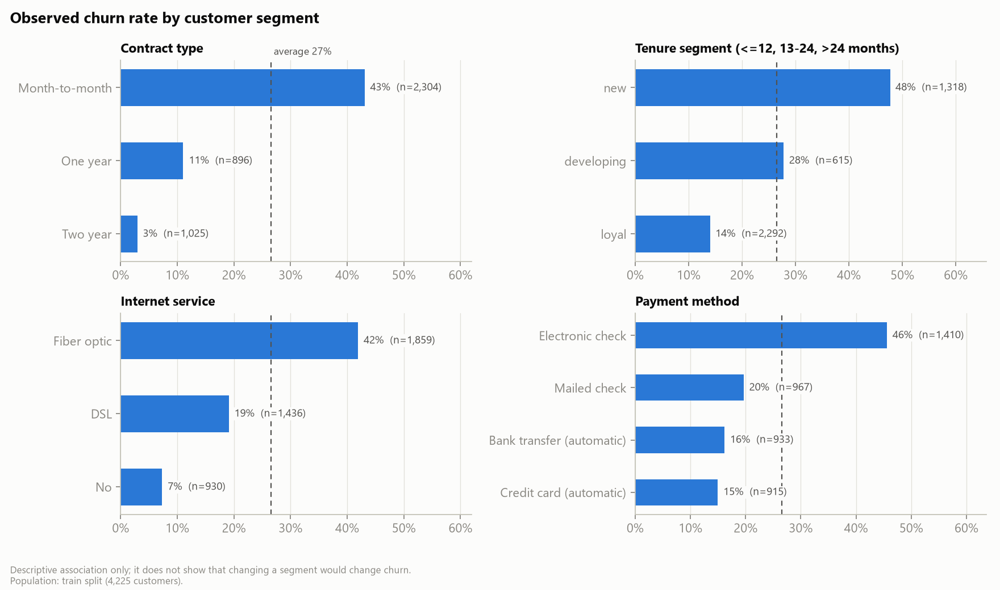

On train, churn is highest for **Month-to-month** (43% vs 3% for Two year); **new** (48% vs 14% for loyal); **Fiber optic** (42% vs 7% for No); **Electronic check** (46% vs 15% for Credit card (automatic)). Customers without TechSupport or OnlineSecurity also churn more. These are associations in observational data, not causes.

Risk and value only partly overlap. Using validation cut-offs (75th percentiles: risk 0.465, value $345), the test customers fall into four segments:

| Segment | Customers | Observed churn | Mean value | Share of value at risk | Contacted: risk-only | Contacted: recommended rule, base budget |
| --- | ---: | ---: | ---: | ---: | ---: | ---: |
| High risk / High value | 57 | 54.4% | $402 | 13.7% | 7 | 56 |
| High risk / Low value | 306 | 59.8% | $221 | 46.1% | 133 | 85 |
| Low risk / High value | 291 | 19.2% | $414 | 20.9% | 0 | 12 |
| Low risk / Low value | 755 | 13.8% | $164 | 19.2% | 0 | 0 |

The high-risk/low-value segment holds the most value at risk in total (46%) but each customer is worth little; risk-only targeting spends almost all its budget there. The recommended rule reaches all 57 high-risk/high-value customers and adds valuable customers at moderate risk.

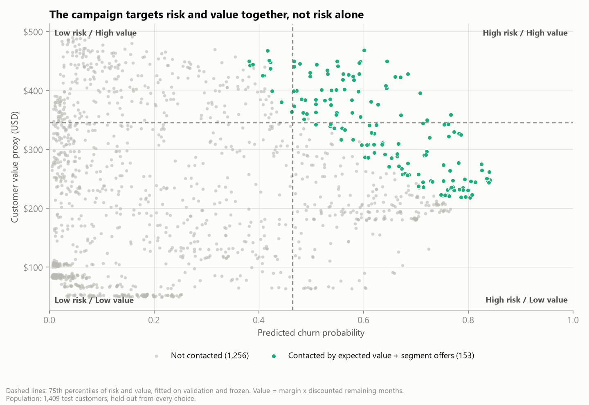

### Why customers leave

IBM's extended version of the sample records a reason for each of the 1,869 churners ([source log](../docs/source-log.md#second-source-churn-reasons-joined-for-description-only)). Reasons are known only after a customer has left, so they are never model inputs; they show what an offer can and cannot fix.

| Reason category | All churners | Churners on the recommended list (test) | Can a price or contract offer address it? |
|---|---:|---:|---|
| Competitor | 33% | 33% | Yes |
| Dissatisfaction | 25% | 27% | No |
| Attitude | 17% | 16% | No |
| Price | 13% | 13% | Yes |
| Other | 11% | 10% | No |

- Only **46%** left for price or a competitor's offer. 42% cite staff attitude or dissatisfaction with the network, product or support, which need service fixes rather than discounts; 3% moved or died and 8% gave no reason.
- **This bounds the save rate.** If offers reach only the addressable churners, the assumed 20% save rate means keeping about **43% of those an offer can reach** - an ambitious figure, and one more reason to measure it in a pilot before scaling.
- The mix hardly differs between segments (largest gap 4 percentage points for segments with at least 100 churners) or on the recommended list (46% addressable). In this sample the reasons cannot steer which offer goes to whom; with real data, reason codes from the call centre should.
- The most common single reason is "Attitude of support person" (10% of churners): service quality is a retention lever outside any offer budget.

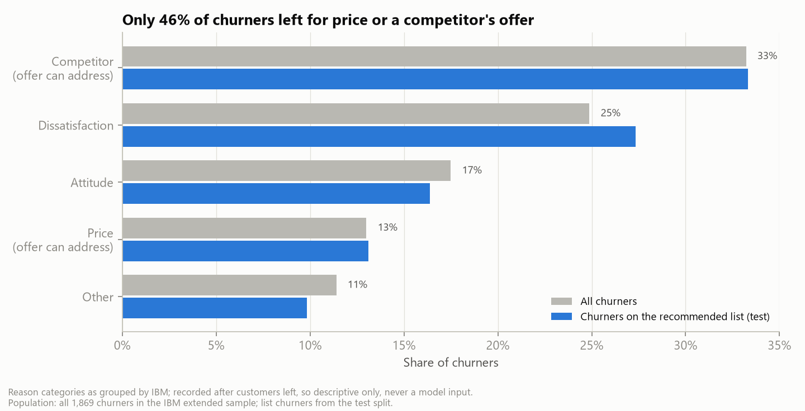

## 5. Churn model

**Candidates:** logistic regression (baseline), random forest (tree-based, required), XGBoost gradient boosting (stretch), each tuned by 5-fold cross-validation on average precision and calibrated with a sigmoid on out-of-fold predictions; a prior-only baseline anchors the metrics.

**Selection (validation, rule fixed in advance):** AP within 0.01 of best calibrated candidate; Brier within 0.002 of best; prefer simpler -> **calibrated Logistic Regression**.

**Test performance:**

| Model | PR-AUC | ROC-AUC | Brier | ECE | Calibration slope | Recall @ threshold |
| --- | ---: | ---: | ---: | ---: | ---: | ---: |
| dummy_raw | 0.265 | 0.500 | 0.195 | 0.022 | n/a | 0.0% |
| logistic_raw | 0.620 | 0.830 | 0.142 | 0.021 | 0.92 | 64.7% |
| logistic_calibrated | 0.620 | 0.830 | 0.142 | 0.019 | 0.94 | 64.7% |
| random_forest_raw | 0.621 | 0.832 | 0.141 | 0.020 | 1.05 | 62.0% |
| random_forest_calibrated | 0.621 | 0.832 | 0.144 | 0.045 | 0.91 | 59.4% |
| xgboost_raw | 0.613 | 0.826 | 0.144 | 0.026 | 0.84 | 62.6% |
| xgboost_calibrated | 0.613 | 0.826 | 0.145 | 0.044 | 0.93 | 57.2% |

The deployed model's PR-AUC is 0.620 (95% interval 0.567-0.671) against a random baseline of 0.265; ROC-AUC 0.830. The three model families rank almost equally well, so the simpler, interpretable and well-calibrated logistic model is deployed.

**Calibration.** Expected value multiplies a probability by money, so calibration matters as much as ranking. The deployed model's ECE is 0.019, slope 0.94 (target 1) and intercept -0.032 (target 0). Sigmoid calibration made little difference to logistic regression and worsened the tree models' ECE on test; this is reported as found.

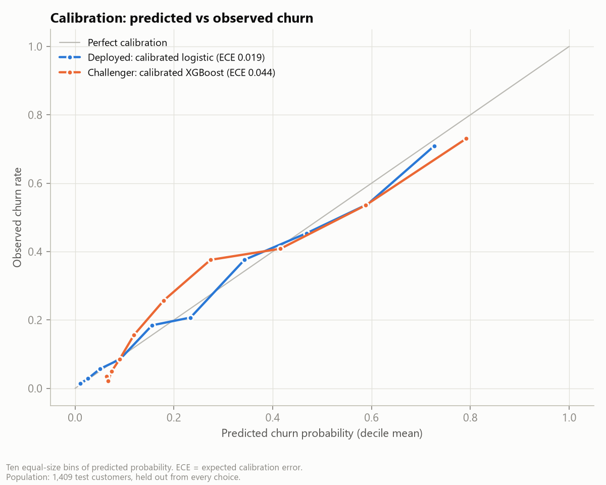

**Threshold analysis.** The F1-optimal threshold on validation is 0.40. A threshold, however, ignores value and cost. On test:

| Rule | Customers | Cost | Expected net value | Precision | Recall |
| --- | ---: | ---: | ---: | ---: | ---: |
| Probability >= 0.40 (F1 threshold) | 433 | $10,825 | $1,989 | 55.9% | 64.7% |
| Expected value > 0 (no budget limit) | 332 | $8,300 | $3,202 | 56.3% | 50.0% |
| Expected value, ranked within the fixed budget | 140 | $3,500 | $2,340 | 60.0% | n/a |

Contacting everyone above the F1 threshold costs more and earns less than contacting everyone with positive expected value. The churn probability a customer needs before an offer pays off (break-even probability) ranges from 29% for the most valuable decile to above 100% (never worth it) for the least valuable, which is why one global threshold cannot be right.

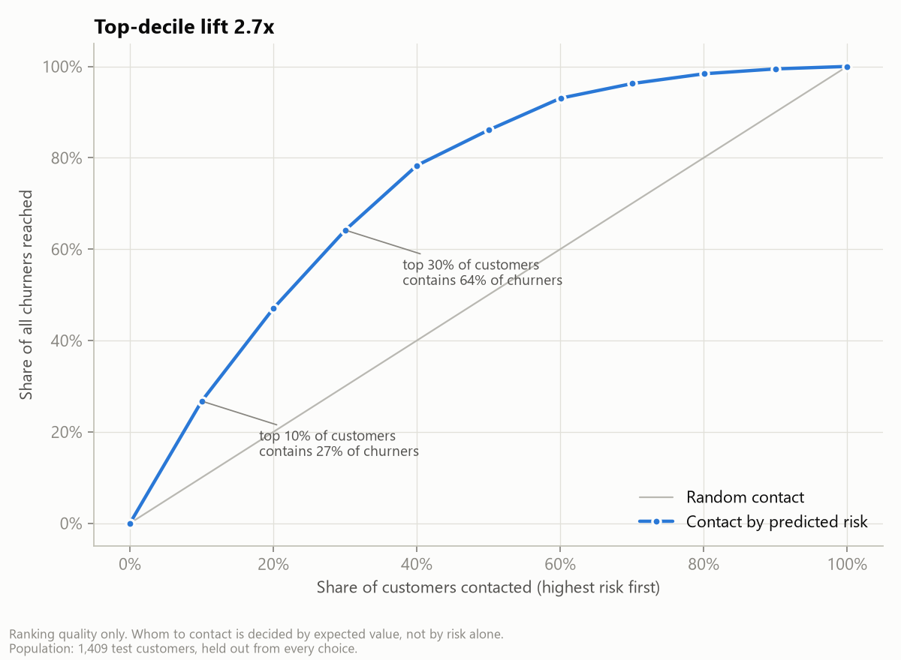

**Error analysis.** Recall and calibration by contract, internet service, payment method, gender and seniority are in [segment errors](tables/segment_errors.csv). The riskiest decile churns at 71% (lift 2.67x); the top three deciles capture 64% of churners.

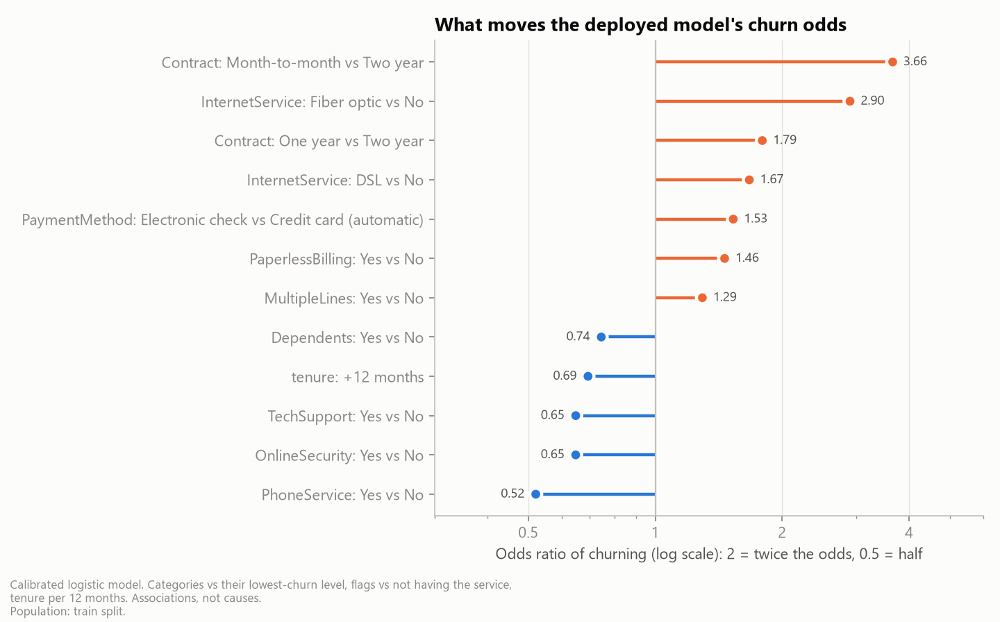

The challenger XGBoost model is explained with SHAP; its leading features (Contract_Month-to-month, tenure, MonthlyCharges, InternetService_Fiber optic) agree with the logistic coefficients.

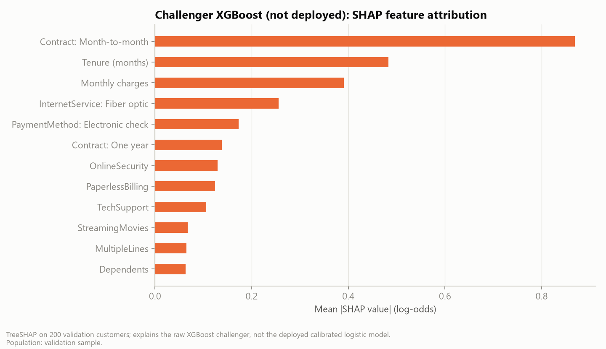

## 6. Decision logic and results at the fixed budget

**Value proxy:** monthly charges x margin 30% x discounted months, with a base horizon of 12 months scaled by tenure (0.75 / 1.0 / 1.25) and a 10% annual discount rate. It is a 12-month truncated value, not a lifetime value.

**Expected value of an offer:** p(churn) x save rate x value - (offer cost + contact cost); offer cost is charged to every contacted customer (unconditional credit), which is conservative.

**Selection:** a mixed-integer knapsack (scipy/HiGHS) maximises total expected value subject to the budget, one offer per customer, offer eligibility and a 30% contact cap; customers with non-positive EV are never contacted. With one offer and equal costs, sorting by EV is provably optimal and is used directly.

**Offers:** a synthetic catalog of four offers with eligibility rules ([assumption register](../docs/assumption-register.md#offer-catalog)). On validation, segment offers beat the single standard offer by 13%, above the 5% rule, so the recommended rule is **expected value + segment offers**.

**Results on test, same budget ($3,500):**

| Rule | Customers | Cost | Expected net value | ROI | Precision | HR/HV coverage | Label-based net |
| --- | ---: | ---: | ---: | ---: | ---: | ---: | ---: |
| No campaign | 0 | $0 | $0 | n/a | n/a | 0.0% | $0 |
| Highest churn risk | 140 | $3,500 | $1,301 | 37.2% | 70.7% | 12.3% | $1,079 |
| Highest risk, positive EV only | 140 | $3,500 | $1,367 | 39.0% | 69.3% | 12.3% | $1,105 |
| Highest customer value | 140 | $3,500 | -$1,037 | -29.6% | 28.6% | 29.8% | $90 |
| Expected value (single offer) | 140 | $3,500 | $2,340 | 66.9% | 60.0% | 96.5% | $1,977 |
| Expected value + segment offers | 153 | $3,500 | $2,668 | 76.2% | 60.1% | 98.2% | $2,156 |
| Random contact (mean of runs) | 140 | $3,500 | -$1,645 | -47.0% | 26.2% | 10.2% | -$1,688 |

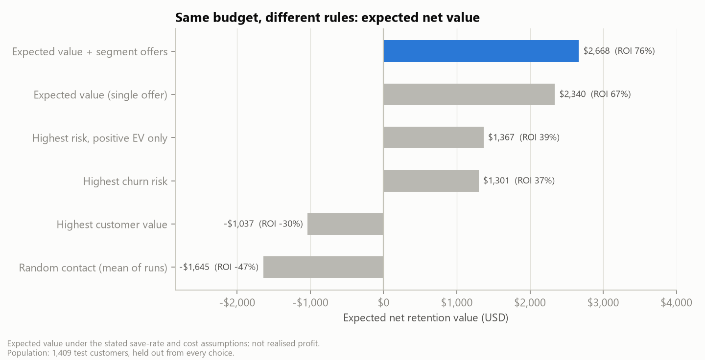

- **Targeting effect:** expected value vs risk-only with the same offer: +$1,039 expected; label-based (actual churn, assumed save rate) +$898, paired bootstrap 95% interval $107 to $1,744.
- **Offer-design effect:** segment offers vs single offer: +$328 expected, label-based +$179 (-$153 to $577). Because this gain comes from assumed offer-specific save rates, it is not evidence that the offers work; the pilot tests each offer as its own arm.
- **Precision vs value:** risk-only has higher precision (71% vs 60%) but lower value, because it contacts high-risk customers whose remaining value cannot repay an offer. Coverage of high-risk/high-value customers is 98% vs 12%.
- **Random contact and value-only targeting lose money** (-$1,645 and -$1,037): offers to customers who would have stayed are pure cost.

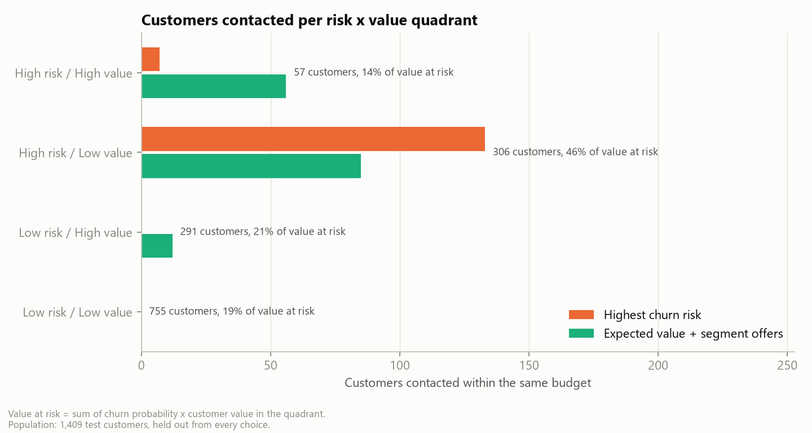

## 7. How robust is the answer?

**One assumption at a time (tornado, list re-optimised within the same budget):**

| Assumption | Low | High | Net at low | Net at high | Frozen list at low | Frozen list at high |
| --- | --- | --- | ---: | ---: | ---: | ---: |
| Save rate of the standard offer | 10% | 30% | $458 | $6,359 | -$469 | $5,806 |
| Value horizon (months) | 6 months | 18 months | $89 | $5,522 | -$336 | $5,522 |
| Offer cost (multiplier on catalog cost) | x0.5 | x1.5 | $6,062 | $1,198 | $4,036 | $1,301 |
| Contribution margin | 20% | 40% | $614 | $4,724 | $612 | $4,724 |
| Contact cost per customer (USD) | $1 | $10 | $3,843 | $1,852 | $3,280 | $1,903 |
| Annual discount rate | 5% | 15% | $2,836 | $2,513 | $2,836 | $2,513 |
| Tenure effect on remaining months (new 1-s, loyal 1+s) | 0% | 50% | $2,973 | $3,280 | $2,427 | $2,885 |

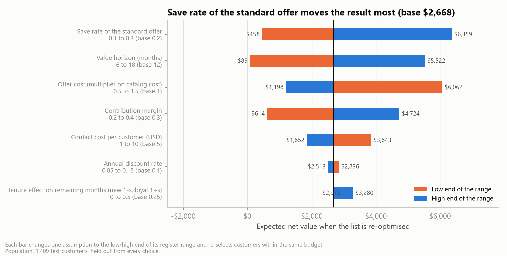

**Save rate x offer cost.** Over the grid, the re-optimised plan ranges from $0 to $15,784; a frozen list ranges from -$4,773 to $10,311. A re-optimised plan cannot lose money only because it assumes we already know the true assumptions and drop customers whose EV turns negative; a list that is sent out, as in a pilot, is frozen and can lose.

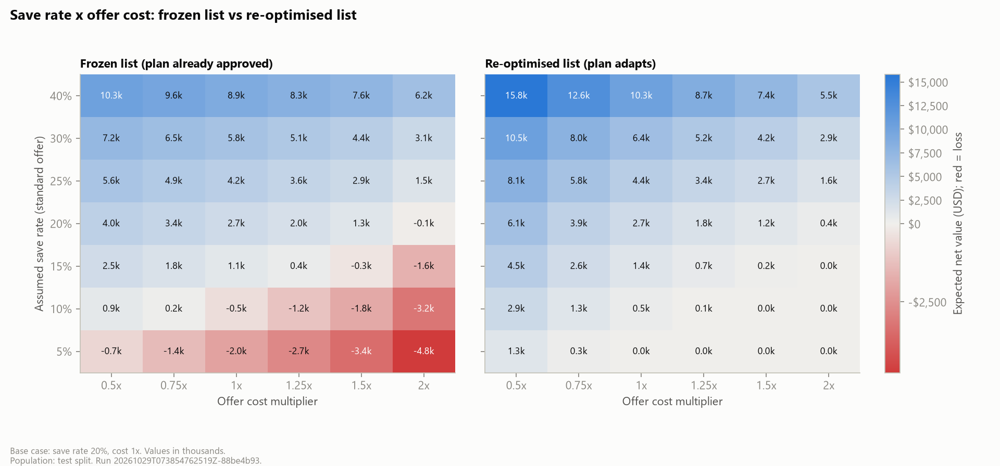

**Combined scenarios:**

| Scenario | Assumptions | Customers | Net (re-optimised) | Net (frozen list) |
|---|---|---:|---:|---:|
| Pessimistic | save rate 10%, offer cost x1.25, contact cost $8, margin 25%, value horizon 9 months | 0 | $0 | -$2,724 |
| Base | assumptions as registered | 153 | $2,668 | $2,668 |
| Optimistic | save rate 30%, offer cost x0.75, contact cost $2, margin 40%, value horizon 15 months | 312 | $19,084 | $12,958 |

**Break-even.** The base-budget list breaks even at a standard-offer save rate of **11.3%** (all offers scaled proportionally) or at offer costs 1.98x today's; the larger recommended list (section 8) breaks even at **13.8%**, because its extra customers have lower expected value (measured as the average save rate of its offer mix, which is what the pilot observes: 15.6% against an assumed 22.6%); below a save rate of 7.7%, no customer has positive EV and the right decision is no campaign. These ranges are scenarios, not confidence intervals.

**All assumptions uncertain at once (Monte Carlo).** Each of the 5,000 draws picks every register assumption from a triangular distribution over its tested range (most likely at the base value), independently, and reprices the frozen lists:

| List (frozen) | Mean net | 5th percentile | Median | 95th percentile | Chance of a loss | Average loss when it loses |
|---|---:|---:|---:|---:|---:|---:|
| Base-budget list ($3,500) | $2,593 | -$469 | $2,375 | $6,282 | 9% | -$639 |
| Recommended list ($9,150) | $3,997 | -$2,444 | $3,639 | $11,532 | 17% | -$1,831 |
| Risk-only list ($3,500) | $1,241 | -$1,267 | $1,080 | $4,304 | 24% | -$796 |

- The larger recommended list earns more on average but is more exposed: it loses money in 17% of draws against 9% for the base-budget list. Valued with customers' actual churn instead of predicted probabilities, the chance of a loss is 22%.
- Against the risk-only list at the same budget, the recommended rule earns more in 100% of draws (median gain $1,240): **who to target is robust; how much an offer saves is not.**
- Value horizon (months), save rate of the standard offer and contribution margin drive most of the spread (rank correlations 0.59, 0.51, 0.42).
- If the true assumptions were known before sending the list, re-optimising would add $846 on average on these 1,409 customers (about $4,227 across the 7,043-customer base, from 200 draws). That is what perfect knowledge of the assumptions is worth for one campaign of this size, and it recurs with every later wave. The pilot's offered half is itself a campaign with positive expected value, so the cost of learning is mainly the value forgone on the held-out half ([pilot design](../docs/pilot-design.md)).

## 8. How much to spend

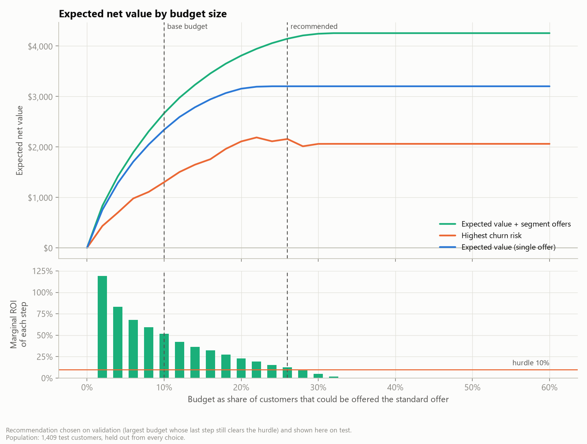

Expected net value rises with the budget at a falling marginal return. The recommendation rule (largest budget whose last step still earns 10%) was applied on validation and chose a budget of **26%** (net-maximising budget on validation: 32%). Budgets are expressed as the share of customers the standard offer could reach ($25 each); because the optimiser mixes cheaper and dearer offers, the share actually contacted differs. Applied to test:

| Budget | Customers contacted | Cost | Expected net value | ROI | Label-based net |
|---|---:|---:|---:|---:|---:|
| Base (10%) | 153 (11%) | $3,500 | $2,668 | 76% | $2,156 |
| Recommended (26%) | 324 (23%) | $9,150 | $4,145 | 45% | $3,377 |

Beyond 371 contacts on test (26% of customers, $11,318) no customer has positive EV and extra budget should stay unspent. Scaled to the 7,043-customer base, the recommended wave is about 1,620 customers and $45,737 for $20,721 expected net value (linear scaling, indicative only).

## 9. Fairness and customer experience

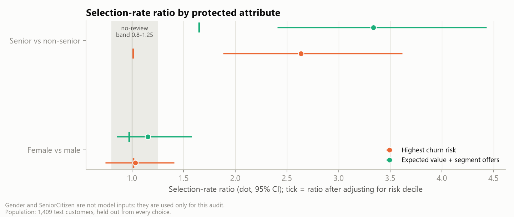

- **Seniors** are contacted 3.34x as often as non-seniors under the recommended rule (risk-only: 2.64x). Adjusted for risk decile the ratio falls to 1.65x: higher churn risk explains part of the gap and higher monthly charges (value) the rest, so adding value to risk widens the gap compared with risk-only targeting. Calibration is also weakest for seniors ([model card](../docs/model-card.md#diagnostics-and-error-analysis)). Being selected means receiving a discount and a call, so the gap is both a benefit and a burden; it is flagged for review rather than corrected automatically.
- **Gender:** ratio 1.15x (interval 0.85-1.58), within normal variation.
- **Loyalty:** one- and two-year contract customers are rarely contacted because their churn risk is low, and long-tenure customers get fewer offers than new ones. The loyalty reward in the catalog is never chosen by the optimiser under current assumptions, so it does not fix this. The playbook recommends a non-targeted loyalty benefit, funded outside the retention budget, to avoid a "loyalty penalty" perception.
- **Contact burden:** the cap (30% of customers), one retention contact per 30 days and legal contact limits (in Vietnam calls 08:00-17:00 and one advertising call per 24 hours) limit intrusiveness.

Gender and seniority are not model inputs. Full table: [fairness.csv](tables/fairness.csv).

## 10. Limitations and external validity

1. **No causal uplift.** The data contain no randomised campaign; all save rates are assumptions. High-risk customers may be the least responsive and contact can backfire (Ascarza 2018; Ascarza et al. 2016). The pilot addresses this.
2. **Teaching sample.** Fictional US company; 26.5% churn label vs about 1% real monthly postpaid churn at US carriers in 2025; IBM describes the churn window inconsistently (month vs quarter). Results demonstrate the method; magnitudes do not transfer.
3. **Vietnam context.** About 90% of Vietnamese mobile subscriptions are prepaid; churn is observed as inactivity or porting, and contract-based features do not exist. The model must be rebuilt on operator data.
4. **Snapshot and random split.** No time-based validation; drift after deployment is unknown.
5. **Value proxy.** No cost-to-serve, no re-churn after a save, no network effects; margin and horizon are assumptions.
6. **Label-based checks** reuse the assumed save rate; they validate *who* is targeted, not *whether offers work*.

### Outside the sample: lower churn and Vietnamese prices

The sample's 26.5% churn is far above real operators'. To show what that does to the answer, every predicted probability was shifted by one constant on the log-odds scale until the average fell to 15%, 10%, 5% (the ranking of customers does not change; [Saerens et al., 2002](../docs/references.md#saerens2002)). A second set of rows prices the same customers like a Vietnamese home-fibre operator: a 250,000 VND monthly bill ($9.76 at 25,603 VND/USD), offers scaled to keep the same share of the bill, and contact by one branded SMS (500 VND). No budget limit; the 30% contact cap still applies.

| Prices | Average churn | Worth an offer | Share | Expected net (USD) | Affordable offer for best 10% (share of bill) | Pilot customers per arm to detect the assumed save rate |
| --- | ---: | ---: | ---: | ---: | ---: | ---: |
| Sample company (USD) | 27% | 371 | 26% | $4,256 | 46% | 287 |
| Sample company (USD) | 15% | 105 | 7% | $519 | 25% | 447 |
| Sample company (USD) | 10% | 25 | 2% | $63 | 15% | 523 |
| Sample company (USD) | 5% | 0 | 0% | $0 | 4% | n/a |
| Vietnam-like prices | 27% | 463 | 33% | $948 | 54% | 304 |
| Vietnam-like prices | 15% | 247 | 18% | $205 | 33% | 525 |
| Vietnam-like prices | 10% | 98 | 7% | $48 | 23% | 689 |
| Vietnam-like prices | 5% | 5 | 0% | $0 | 12% | 916 |

- **Lower churn shrinks the list fast.** At 15% average churn only 7% of customers are worth the $20 offer plus $5 contact (against 26% in the sample); at 5%, 0%.
- **Cheap contact matters more than the offer.** With Vietnamese prices the money per customer is small, but an SMS costs almost nothing, so 18% of customers stay worth an offer at 15% churn.
- **The pilot must grow.** Lower churn on the list means fewer departures to observe: from 287 customers per arm in the sample to 447 at 15% churn, before any time effects.
- The value horizon is held fixed; with lower churn, saved customers would stay longer, so these rows understate value. They show direction, not a forecast.

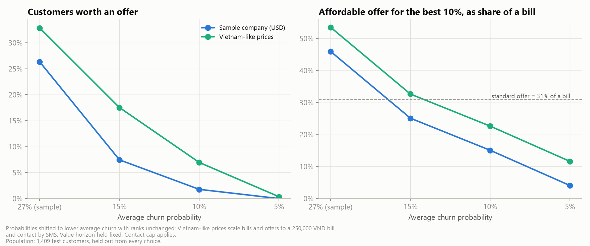

## 11. Recommendations and next steps

1. Adopt expected-value targeting (expected value + segment offers) for the next wave, with the recommended budget ($6.49 per customer in the base).
2. Run it as a randomised pilot: 1,620 customers, half held out, 90-day outcome ([pilot design](../docs/pilot-design.md)); go if the offer effect is significant and the measured save rate of its offer mix is at least the list's break-even of 15.6% (probability of go 97% if it equals the assumed 22.6%).
3. Replace assumed save rates, margin and costs with measured values; re-run the pipeline.
4. Retrain on own data with time-based validation; after several waves, move to uplift targeting.
5. Operate under the controls in [governance and risks](../docs/governance-and-risks.md) and the [retention playbook](../docs/retention-playbook.md).
6. Log customers' reasons for leaving in the call centre and act on service problems (attitude, network, support: 42% of churners in the sample), which no offer budget fixes.
7. Before any use outside this sample, size offers, contact and the pilot from the operator's own churn level ([Vietnam deployment note](../docs/deployment-vietnam.md)).

## 12. Reproducibility

`python -m telco_retention run-all` downloads (checksum-verified), prepares, trains, evaluates, simulates and regenerates every table, figure, document, notebook, the brief (DOCX/PDF) and the deck. The run manifest stores the configuration, dependency versions and code hashes; the dashboard shows the same scenario ID as this report for the default assumptions. Verification evidence: [verification](../docs/verification.md).

## Appendix: figures

| Figure | Population | Caption |
|---|---|---|
| [Observed churn rate by segment](figures/eda_drivers.png) | train split (4,225 customers) | Descriptive association only; it does not show that changing a segment would change churn. |
| [Calibration (reliability) curve](figures/calibration.png) | 1,409 test customers, held out from every choice | Ten equal-size bins of predicted probability. ECE = expected calibration error. |
| [Discrimination of the deployed model](figures/discrimination.png) | 1,409 test customers, held out from every choice | AP (average precision) is the area under the precision-recall curve; it is the primary metric because churners are 27% of customers. |
| [Cumulative gains](figures/gains.png) | 1,409 test customers, held out from every choice | Ranking quality only. Whom to contact is decided by expected value, not by risk alone. |
| [Risk x value map](figures/risk_value.png) | 1,409 test customers, held out from every choice | Dashed lines: 75th percentiles of risk and value, fitted on validation and frozen. Value = margin x discounted remaining months. |
| [Who each rule contacts](figures/quadrant_selection.png) | 1,409 test customers, held out from every choice | Value at risk = sum of churn probability x customer value in the quadrant. |
| [Strategy comparison at the fixed budget](figures/strategy_comparison.png) | 1,409 test customers, held out from every choice | Expected value under the stated save-rate and cost assumptions; not realised profit. |
| [Profit curve and marginal ROI](figures/profit_curve.png) | 1,409 test customers, held out from every choice | Recommendation chosen on validation (largest budget whose last step still clears the hurdle) and shown here on test. |
| [One-way sensitivity (tornado)](figures/tornado.png) | 1,409 test customers, held out from every choice | Each bar changes one assumption to the low/high end of its register range and re-selects customers within the same budget. |
| [Save rate x offer cost sensitivity](figures/sensitivity_heatmap.png) | test | Frozen vs re-optimised list. |
| [Allocation audit by protected attribute](figures/fairness.png) | 1,409 test customers, held out from every choice | Gender and SeniorCitizen are not model inputs; they are used only for this audit. |
| [Deployed model drivers](figures/model_drivers.png) | train split | Calibrated logistic model. Categories vs their lowest-churn level, flags vs not having the service,
tenure per 12 months. Associations, not causes. |
| [Challenger model SHAP](figures/shap_challenger.png) | validation sample | TreeSHAP on 200 validation customers; explains the raw XGBoost challenger, not the deployed calibrated logistic model. |
| [Why churners left](figures/churn_reasons.png) | all 1,869 churners in the IBM extended sample; list churners from the test split | Reason categories as grouped by IBM; recorded after customers left, so descriptive only, never a model input. |
| [Outside the sample](figures/stress_test.png) | 1,409 test customers, held out from every choice | Probabilities shifted to lower average churn with ranks unchanged; Vietnam-like prices scale bills and offers to a 250,000 VND bill
and contact by SMS. Value horizon held fixed. Contact cap applies. |
| [Joint uncertainty of the assumptions](figures/monte_carlo.png) | 1,409 test customers, held out from every choice | 5,000 draws; every register assumption drawn at once from a triangular distribution (low, base, high).
Lists and offers are frozen, as they would be in a pilot; shaded area = loss; the most extreme 0.2% at each end are not drawn. |
| [Target profile](figures/target_profile.png) | 1,409 test customers, held out from every choice | Share of customers with each attribute, on the recommended list and among all test customers. |
