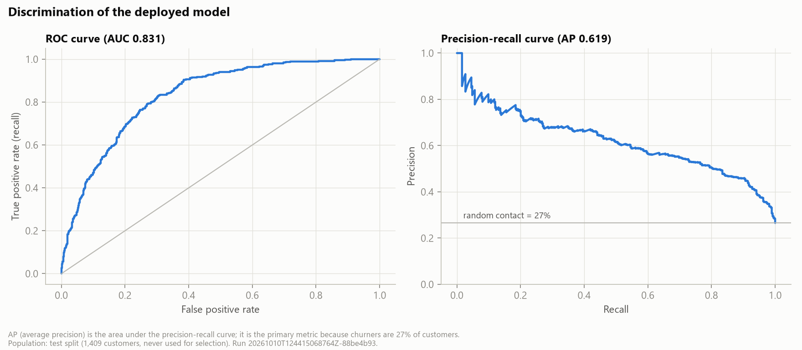
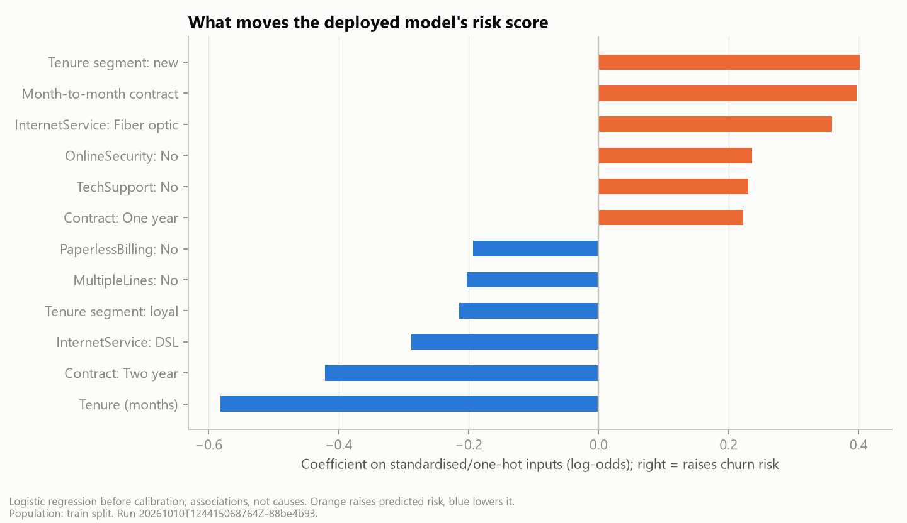
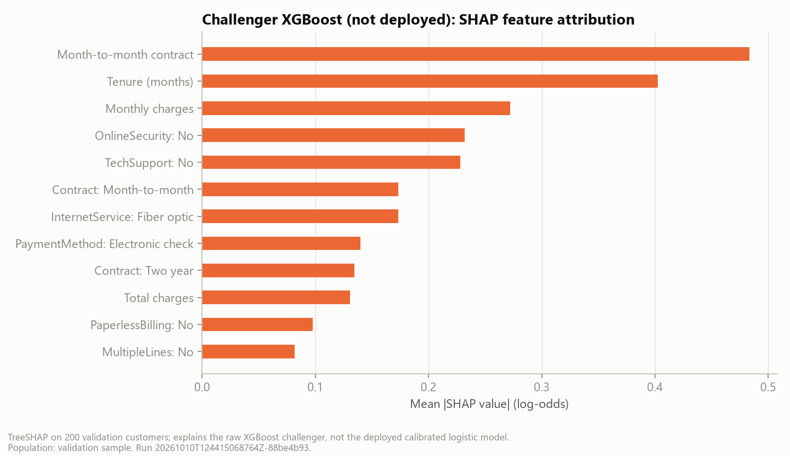
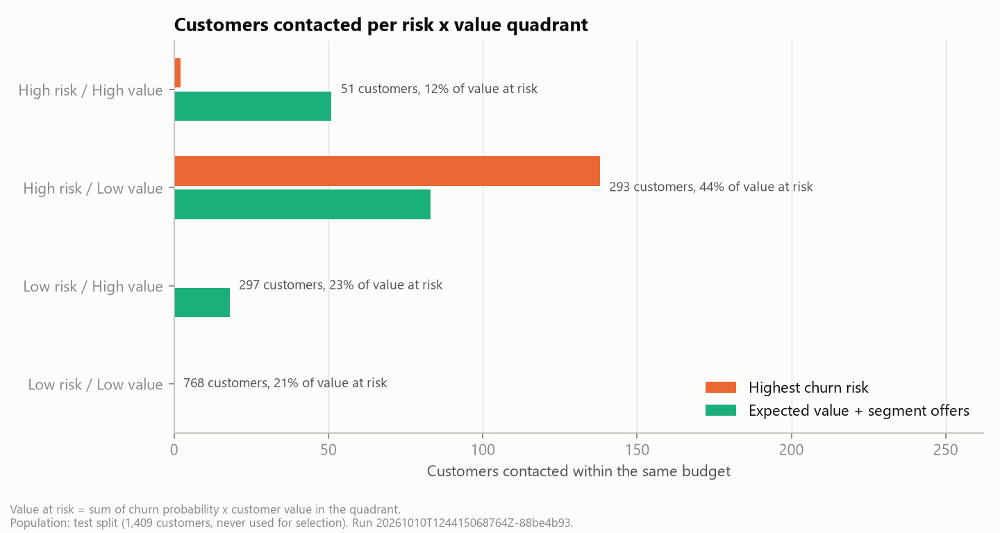

<!-- Generated from src/telco_retention/templates/reports/analysis-report.md.j2 for run 20261010T124415068764Z-88be4b93. Edit the template, not this file. -->
# Analysis report: profit-aware churn and retention targeting

Run `20261010T124415068764Z-88be4b93` · every number below is generated from this run's artifacts ([facts.json](facts.json) maps each to its source file) · all money in USD of the sample company · expected values are scenarios under stated assumptions, not realised profit.

## 1. Summary

- **Question:** with a limited retention budget, which customers should receive an offer when both churn risk and economic value count?
- **Answer:** rank customers by expected net value of an offer (p(churn) x save rate x value - cost), let an optimiser pick the customer-offer combination within budget, and size the budget where the marginal return falls below 10%.
- **Impact (test split, same $3,500 budget):** expected value + segment offers $2,420 vs $1,098 for risk-only targeting (+$1,322); label-based check of the targeting gain $1,308 (95% interval $509 to $2,153).
- **Budget:** 24% of the base (validation rule) gives $3,692 on test from $8,450.
- **Main risk:** the save rate is assumed. Break-even 11.8% vs assumed 20%; a randomised pilot measures it before scale-up.

## 2. Business question and decision

The decision owner (Head of Customer Retention) chooses, for each campaign wave, the contact list, the offer per customer and the budget. Today's rule contacts the highest-risk customers. The [business case](../docs/business-case.md) lists stakeholders, options and KPI definitions; the course requirements are mapped to evidence in [requirements traceability](../docs/requirements-traceability.md).

## 3. Data and readiness

IBM Telco Customer Churn sample: 7,043 customers, 21 columns, 26.5% churners, fictional US company ([source log](../docs/source-log.md), [data dictionary](../docs/data-dictionary.md), [cleaning log](../docs/cleaning-log.md)). Cleaning removed 0 duplicates and set 11 blank `TotalCharges` of new customers to 0. Stratified split train/validation/test = 4,225 / 1,409 / 1,409; all choices are made on validation and test is used once. The [data readiness review](../docs/data-readiness-review.md) concludes the data are fit to design the method but not to size a real campaign (fictional, single snapshot, no offer-response data).

## 4. Who churns, and who is worth saving

On train, churn is highest for **Month-to-month** (43% vs 3% for Two year); **new** (48% vs 14% for loyal); **Fiber optic** (42% vs 7% for No); **Electronic check** (46% vs 15% for Credit card (automatic)). Customers without TechSupport or OnlineSecurity also churn more. These are associations in observational data, not causes.

Risk and value only partly overlap. Using validation cut-offs (75th percentiles: risk 0.457, value $345), the test customers fall into four segments:

| Segment | Customers | Observed churn | Mean value | Share of value at risk | Contacted: risk-only | Contacted: recommended |
| --- | ---: | ---: | ---: | ---: | ---: | ---: |
| High risk / High value | 51 | 52.9% | $402 | 11.9% | 2 | 51 |
| High risk / Low value | 293 | 60.4% | $213 | 43.9% | 138 | 83 |
| Low risk / High value | 297 | 20.2% | $414 | 23.5% | 0 | 18 |
| Low risk / Low value | 768 | 14.3% | $168 | 20.7% | 0 | 0 |

The high-risk/low-value segment holds the most value at risk in total (44%) but each customer is worth little; risk-only targeting spends almost all its budget there. The recommended rule reaches all 51 high-risk/high-value customers and adds valuable customers at moderate risk.

## 5. Churn model

**Candidates:** logistic regression (baseline), random forest (tree-based, required), XGBoost gradient boosting (stretch), each tuned by 5-fold cross-validation on average precision and calibrated with a sigmoid on out-of-fold predictions; a prior-only baseline anchors the metrics.

**Selection (validation, rule fixed in advance):** AP within 0.01 of best calibrated candidate; Brier within 0.002 of best; prefer simpler -> **calibrated Logistic Regression**.

**Test performance:**

| Model | PR-AUC | ROC-AUC | Brier | ECE | Calibration slope | Recall @ threshold |
| --- | ---: | ---: | ---: | ---: | ---: | ---: |
| dummy_raw | 0.265 | 0.500 | 0.195 | 0.022 | n/a | 0.0% |
| logistic_raw | 0.619 | 0.831 | 0.142 | 0.020 | 0.93 | 70.9% |
| logistic_calibrated | 0.619 | 0.831 | 0.142 | 0.020 | 0.93 | 70.9% |
| random_forest_raw | 0.629 | 0.831 | 0.141 | 0.017 | 0.99 | 68.7% |
| random_forest_calibrated | 0.629 | 0.831 | 0.143 | 0.035 | 0.92 | 65.2% |
| xgboost_raw | 0.633 | 0.831 | 0.141 | 0.019 | 0.92 | 70.6% |
| xgboost_calibrated | 0.633 | 0.831 | 0.143 | 0.048 | 0.94 | 61.5% |

The deployed model's PR-AUC is 0.619 (95% interval 0.568-0.669) against a random baseline of 0.265; ROC-AUC 0.831. The three model families rank almost equally well, so the simpler, interpretable and well-calibrated logistic model is deployed.

**Calibration.** Expected value multiplies a probability by money, so calibration matters as much as ranking. The deployed model's ECE is 0.020, slope 0.93 (target 1) and intercept -0.022 (target 0). Sigmoid calibration made little difference to logistic regression and worsened the tree models' ECE on test; this is reported as found.

**Threshold analysis.** The F1-optimal threshold on validation is 0.35. A threshold, however, ignores value and cost. On test:

| Rule | Customers | Cost | Expected net value | Precision | Recall |
| --- | ---: | ---: | ---: | ---: | ---: |
| Probability >= 0.35 (F1 threshold) | 487 | $12,175 | $1,405 | 54.4% | 70.9% |
| Expected value > 0 (no budget limit) | 329 | $8,225 | $2,916 | 56.8% | 50.0% |
| Expected value, ranked within the fixed budget | 140 | $3,500 | $2,130 | 62.1% | n/a |

Contacting everyone above the F1 threshold costs more and earns less than contacting everyone with positive expected value. The churn probability a customer needs before an offer pays off (break-even probability) ranges from 29% for the most valuable decile to above 100% (never worth it) for the least valuable, which is why one global threshold cannot be right.

**Error analysis.** Recall and calibration by contract, internet service, payment method, gender and seniority are in [segment errors](tables/segment_errors.csv). The riskiest decile churns at 70% (lift 2.65x); the top three deciles capture 64% of churners.

The challenger XGBoost model is explained with SHAP; its leading features (monthly_contract, tenure, MonthlyCharges, OnlineSecurity_No) agree with the logistic coefficients.

## 6. Decision logic and results at the fixed budget

**Value proxy:** monthly charges x margin 30% x discounted months, with a base horizon of 12 months scaled by tenure (0.75 / 1.0 / 1.25) and a 10% annual discount rate. It is a 12-month truncated value, not a lifetime value.

**Expected value of an offer:** p(churn) x save rate x value - (offer cost + contact cost); offer cost is charged to every contacted customer (unconditional credit), which is conservative.

**Selection:** a mixed-integer knapsack (scipy/HiGHS) maximises total expected value subject to the budget, one offer per customer, offer eligibility and a 30% contact cap; customers with non-positive EV are never contacted. With one offer and equal costs, sorting by EV is provably optimal and is used directly.

**Offers:** a synthetic catalog of four offers with eligibility rules ([assumption register](../docs/assumption-register.md#offer-catalog)). On validation, segment offers beat the single standard offer by 12%, above the 5% rule, so the recommended rule is **expected value + segment offers**.

**Results on test, same budget ($3,500):**

| Rule | Customers | Cost | Expected net value | ROI | Precision | HR/HV coverage | Label-based net |
| --- | ---: | ---: | ---: | ---: | ---: | ---: | ---: |
| No campaign | 0 | $0 | $0 | n/a | n/a | 0.0% | $0 |
| Highest churn risk | 140 | $3,500 | $1,098 | 31.4% | 70.0% | 3.9% | $775 |
| Highest risk, positive EV only | 140 | $3,500 | $1,256 | 35.9% | 68.6% | 5.9% | $864 |
| Highest customer value | 140 | $3,500 | -$901 | -25.8% | 28.6% | 29.4% | $90 |
| Expected value (single offer) | 140 | $3,500 | $2,130 | 60.9% | 62.1% | 96.1% | $2,083 |
| Expected value + segment offers | 152 | $3,499 | $2,420 | 69.2% | 59.9% | 100.0% | $2,056 |
| Random contact (mean of runs) | 140 | $3,500 | -$1,664 | -47.5% | 26.2% | 10.2% | -$1,688 |

- **Targeting effect:** expected value vs risk-only with the same offer: +$1,032 expected; label-based (actual churn, assumed save rate) +$1,308, paired bootstrap 95% interval $509 to $2,153.
- **Offer-design effect:** segment offers vs single offer: +$290 expected, label-based -$27 (-$372 to $316). Because this gain comes from assumed offer-specific save rates, it is not evidence that the offers work; the pilot tests each offer as its own arm.
- **Precision vs value:** risk-only has higher precision (70% vs 60%) but lower value, because it contacts high-risk customers whose remaining value cannot repay an offer. Coverage of high-risk/high-value customers is 100% vs 4%.
- **Random contact and value-only targeting lose money** (-$1,664 and -$901): offers to customers who would have stayed are pure cost.

## 7. How robust is the answer?

**One assumption at a time (tornado, list re-optimised within the same budget):**

| Assumption | Low | High | Net at low | Net at high | Frozen list at low | Frozen list at high |
| --- | --- | --- | ---: | ---: | ---: | ---: |
| Save rate of the standard offer | 0.1 | 0.3 | $326 | $6,050 | -$588 | $5,428 |
| Value horizon (months) | 6.0 | 18.0 | $51 | $5,163 | -$465 | $5,163 |
| Offer cost (multiplier on catalog cost) | 0.5 | 1.5 | $5,724 | $1,015 | $3,790 | $1,051 |
| Contribution margin | 0.2 | 0.4 | $465 | $4,393 | $447 | $4,393 |
| Contact cost per customer (USD) | 1.0 | 10.0 | $3,617 | $1,615 | $3,028 | $1,660 |
| Annual discount rate | 0.05 | 0.15 | $2,578 | $2,275 | $2,578 | $2,274 |

**Save rate x offer cost.** Over the grid, the re-optimised plan ranges from $0 to $15,298; a frozen list ranges from -$4,831 to $9,806. Re-optimising never loses money because it stops contacting customers whose EV turns negative; a frozen list can.

**Combined scenarios:**

| Scenario | Assumptions | Customers | Net (re-optimised) | Net (frozen list) |
|---|---|---:|---:|---:|
| Pessimistic | `{"save_rate": 0.1, "offer_cost_multiplier": 1.25, "contact_cost": 8.0, "value.margin": 0.25, "value.base_horizon_months": 9}` | 0 | $0 | -$2,797 |
| Base | `{}` | 152 | $2,420 | $2,420 |
| Optimistic | `{"save_rate": 0.3, "offer_cost_multiplier": 0.75, "contact_cost": 2.0, "value.margin": 0.4, "value.base_horizon_months": 15}` | 313 | $18,525 | $12,338 |

**Break-even.** The recommended list breaks even at a standard-offer save rate of **11.8%** (all offers scaled proportionally) or at offer costs 1.88x today's; below a save rate of 8.9%, no customer has positive EV and the right decision is no campaign. These ranges are scenarios, not confidence intervals.

## 8. How much to spend

Expected net value rises with the budget at a falling marginal return. The recommendation rule (largest budget whose last step still earns 10%) was applied on validation and chose **24%** of customers (net-maximising share on validation: 32%). Applied to test:

| Budget | Customers | Cost | Expected net value | ROI | Label-based net |
|---|---:|---:|---:|---:|---:|
| Base (10%) | 152 | $3,499 | $2,420 | 69% | $2,056 |
| Recommended (24%) | 310 | $8,450 | $3,692 | 44% | $3,286 |

Beyond about 27% of customers (383 on test, $11,378) no customer has positive EV and extra budget should stay unspent. Scaled to the 7,043-customer base, the recommended wave is about $42,238 for $18,454 expected net value (linear scaling, indicative only).

## 9. Fairness and customer experience

- **Seniors** are contacted 3.66x as often as non-seniors under the recommended rule (risk-only: 2.40x). Adjusted for risk decile the ratio falls to 1.74x: most of the gap comes from higher churn risk, the rest from higher monthly charges (value). Being selected means receiving a discount and a call, so the gap is both a benefit and a burden; it is flagged for review rather than corrected automatically.
- **Gender:** ratio 1.14x (interval 0.83-1.55), within normal variation.
- **Loyalty:** one- and two-year contract customers are not contacted because their churn risk is low; long-tenure customers get fewer offers than new ones. A loyalty reward is in the catalog and the playbook recommends a non-targeted loyalty benefit to avoid a "loyalty penalty" perception.
- **Contact burden:** the cap (30% of customers), one retention contact per 30 days, and the legal call window (08:00-17:00, one advertising call per 24 hours) limit intrusiveness.

Gender and seniority are not model inputs. Full table: [fairness.csv](tables/fairness.csv).

## 10. Limitations and external validity

1. **No causal uplift.** The data contain no randomised campaign; all save rates are assumptions. High-risk customers may be the least responsive and contact can backfire (Ascarza 2018; Ascarza et al. 2016). The pilot addresses this.
2. **Teaching sample.** Fictional US company; 26.5% churn label vs about 1% real monthly postpaid churn at US carriers in 2025; IBM describes the churn window inconsistently (month vs quarter). Results demonstrate the method; magnitudes do not transfer.
3. **Vietnam context.** About 90% of Vietnamese mobile subscriptions are prepaid; churn is observed as inactivity or porting, and contract-based features do not exist. The model must be rebuilt on operator data.
4. **Snapshot and random split.** No time-based validation; drift after deployment is unknown.
5. **Value proxy.** No cost-to-serve, no re-churn after a save, no network effects; margin and horizon are assumptions.
6. **Label-based checks** reuse the assumed save rate; they validate *who* is targeted, not *whether offers work*.

## 11. Recommendations and next steps

1. Adopt expected-value targeting (expected value + segment offers) for the next wave, sized at 24% of the base.
2. Run it as a randomised pilot: 1,690 customers, half held out, 90-day outcome ([pilot design](../docs/pilot-design.md)); go only if the measured save rate's lower bound exceeds 11.8%.
3. Replace assumed save rates, margin and costs with measured values; re-run the pipeline.
4. Retrain on own data with time-based validation; after several waves, move to uplift targeting.
5. Operate under the controls in [governance and risks](../docs/governance-and-risks.md) and the [retention playbook](../docs/retention-playbook.md).

## 12. Reproducibility

`python -m telco_retention run-all` downloads (checksum-verified), prepares, trains, evaluates, simulates and regenerates every table, figure, document, notebook, the brief (DOCX/PDF) and the deck. The run manifest stores the configuration, dependency versions and code hashes; the dashboard shows the same scenario ID as this report for the default assumptions. Verification evidence: [verification](../docs/verification.md).

## Appendix: figures

| Figure | Population | Caption |
|---|---|---|
| [Observed churn rate by segment](figures/eda_drivers.png) | train split (4,225 customers) | Descriptive association only; it does not show that changing a segment would change churn. |
| [Calibration (reliability) curve](figures/calibration.png) | test split (1,409 customers, never used for selection) | Ten equal-size bins of predicted probability. ECE = expected calibration error. |
| [Discrimination of the deployed model](figures/discrimination.png) | test split (1,409 customers, never used for selection) | AP (average precision) is the area under the precision-recall curve; it is the primary metric because churners are 27% of customers. |
| [Cumulative gains](figures/gains.png) | test split (1,409 customers, never used for selection) | Ranking quality only. Whom to contact is decided by expected value, not by risk alone. |
| [Risk x value map](figures/risk_value.png) | test split (1,409 customers, never used for selection) | Dashed lines: 75th percentiles of risk and value, fitted on validation and frozen. Value = margin x discounted remaining months. |
| [Who each rule contacts](figures/quadrant_selection.png) | test split (1,409 customers, never used for selection) | Value at risk = sum of churn probability x customer value in the quadrant. |
| [Strategy comparison at the fixed budget](figures/strategy_comparison.png) | test split (1,409 customers, never used for selection) | Expected value under the stated save-rate and cost assumptions; not realised profit. |
| [Profit curve and marginal ROI](figures/profit_curve.png) | test split (1,409 customers, never used for selection) | Recommendation chosen on validation (largest budget whose last step still clears the hurdle) and shown here on test. |
| [One-way sensitivity (tornado)](figures/tornado.png) | test split (1,409 customers, never used for selection) | Each bar changes one assumption to the low/high end of its register range and re-selects customers within the same budget. |
| [Save rate x offer cost sensitivity](figures/sensitivity_heatmap.png) | test | Frozen vs re-optimised list. |
| [Allocation audit by protected attribute](figures/fairness.png) | test split (1,409 customers, never used for selection) | Gender and SeniorCitizen are not model inputs; they are used only for this audit. |
| [Deployed model drivers](figures/model_drivers.png) | train split | Logistic regression before calibration; associations, not causes. Orange raises predicted risk, blue lowers it. |
| [Challenger model SHAP](figures/shap_challenger.png) | validation sample | TreeSHAP on 200 validation customers; explains the raw XGBoost challenger, not the deployed calibrated logistic model. |
