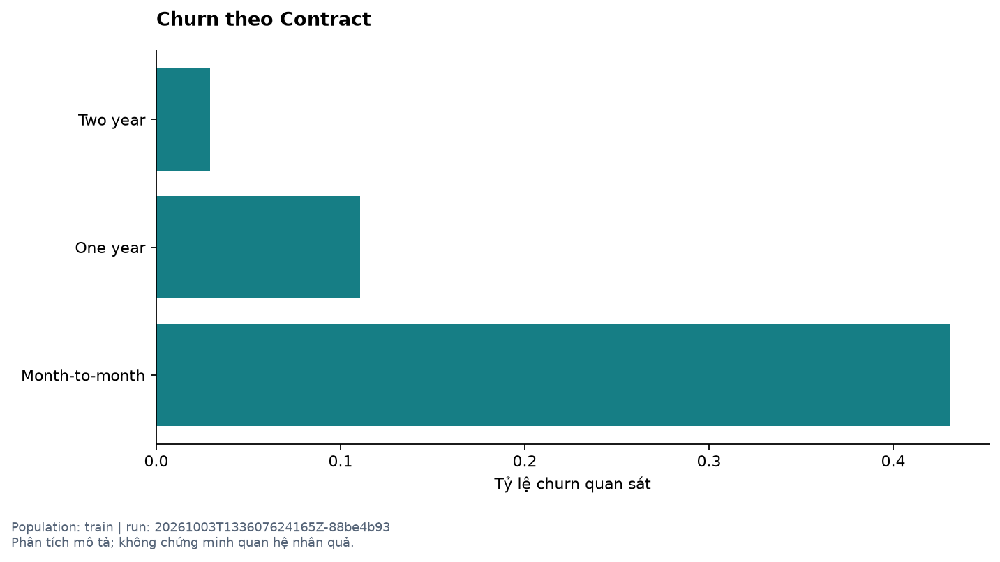
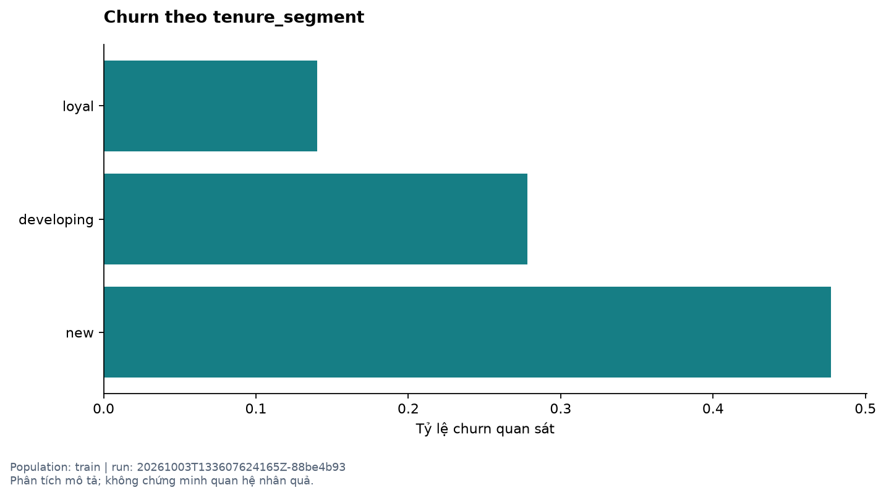
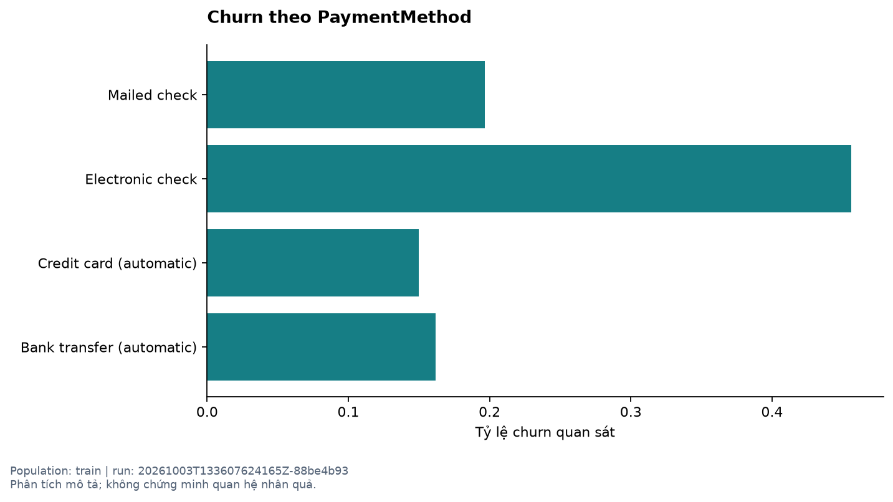
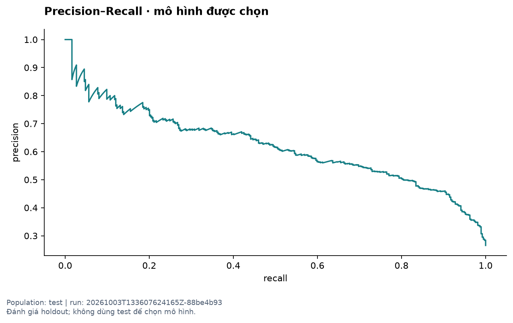
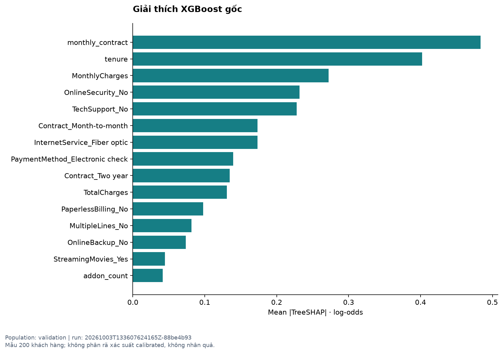
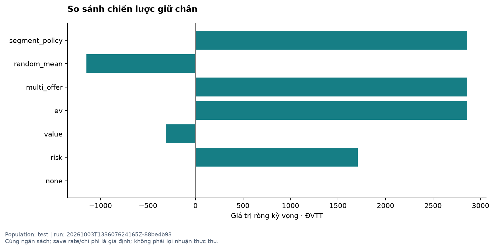
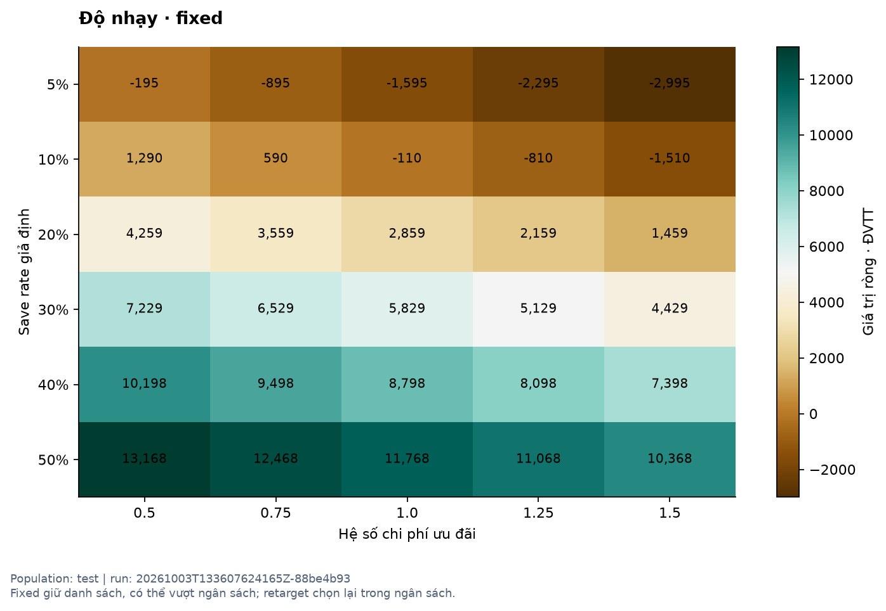
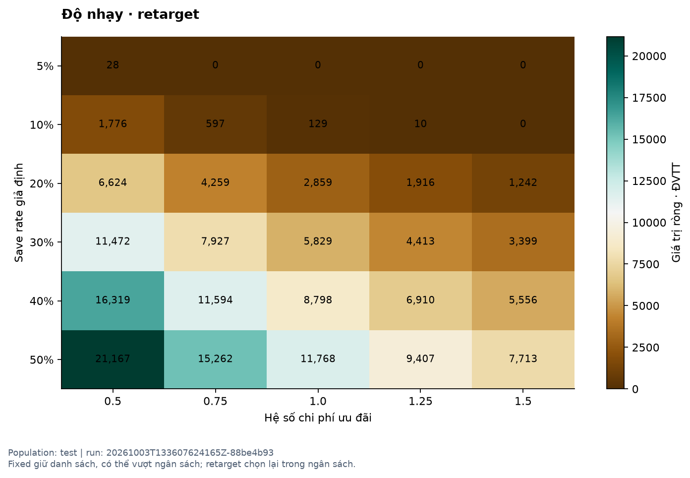
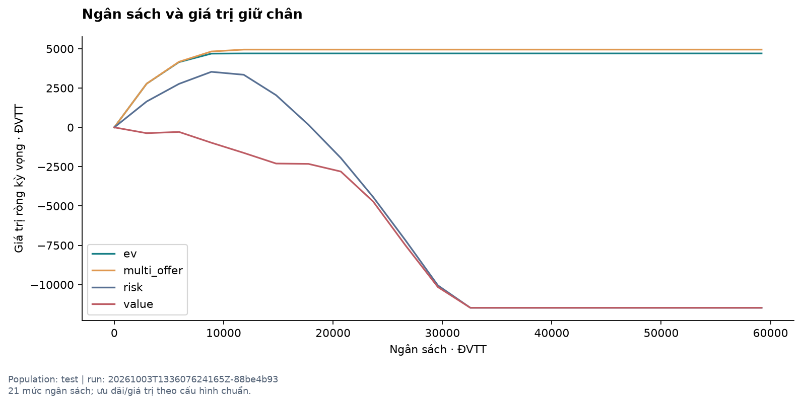
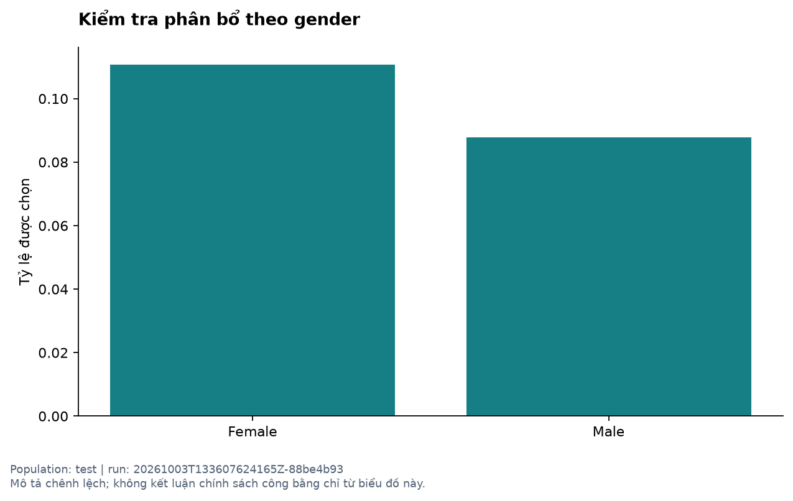

# Hồ sơ phân tích Telecom Churn & Retention Targeting

Run `20261003T133607624165Z-88be4b93` · nguồn `Kaggle blastchar/telco-customer-churn` · scenario chuẩn `765d0287b0f6`.

Tài liệu này là nguồn nội dung cho báo cáo và slide. Tất cả số liệu bên dưới được sinh từ pipeline đã chạy; không phải số mẫu. Tiền là ĐVTT. Save rate, chi phí, margin và horizon là giả định.

## Mục lục

1. [Bối cảnh](#1-bối-cảnh-và-quyết-định)
2. [Dữ liệu](#2-dữ-liệu-và-chất-lượng)
3. [EDA](#3-khám-phá-dữ-liệu)
4. [Kiểm định](#4-thiết-kế-kiểm-định)
5. [Mô hình](#5-kết-quả-mô-hình)
6. [Giải thích](#6-giải-thích-đặc-trưng)
7. [Giá trị](#7-giá-trị-khách-hàng-và-ưu-đãi)
8. [Targeting](#8-so-sánh-chiến-lược)
9. [Độ nhạy](#9-độ-nhạy-và-ngân-sách)
10. [Phân khúc và công bằng](#10-chính-sách-phân-khúc-và-công-bằng)
11. [Khuyến nghị](#11-khuyến-nghị-quản-lý)
12. [Giới hạn](#12-giới-hạn)
13. [Demo](#13-kịch-bản-demo)
14. [Dàn ý slide](#14-dàn-ý-slide-và-danh-mục-bằng-chứng)

## 1. Bối cảnh và quyết định

Doanh nghiệp viễn thông có ngân sách giữ chân hữu hạn. Quyết định là chọn ai và ưu đãi nào để tạo giá trị giữ chân ròng kỳ vọng tốt nhất. Dự đoán churn là đầu vào, không phải đích cuối. Người sử dụng chính là quản lý chiến dịch và người phân tích hỗ trợ ra quyết định.

Thành công được đánh giá ở ba mức: phân biệt và hiệu chỉnh xác suất; chất lượng danh sách targeting; giá trị kinh tế dưới giả định minh bạch. Không đặt KPI mô hình tùy ý để buộc kết quả đạt một con số mong muốn.

## 2. Dữ liệu và chất lượng

Nguồn thực tế: [Kaggle blastchar/telco-customer-churn](https://www.kaggle.com/datasets/blastchar/telco-customer-churn). Có 7,043 dòng, 21 cột. Checksum `88be4b93fbe0cc83421af1c503794c97c342eca914c1576db7c276e61d61358a`. [Source log](../docs/source-log.md), [data dictionary](../docs/data-dictionary.md), [cleaning log](../docs/cleaning-log.md).

Có 11 TotalCharges trống; 11 trường hợp tenure=0 được điền 0. Loại 0 dòng trùng hoàn toàn. Không nối nguồn khách hàng ngoài; không loại outlier hợp lệ. Ưu đãi là dữ liệu tổng hợp có nguồn gốc riêng và các giá trị công khai.

## 3. Khám phá dữ liệu

EDA thiết kế trên tập train; không sử dụng test để tạo features hoặc sửa giả định.

| attribute      | group          |    n |   churn_rate |   mean_monthly_charges |   mean_tenure |
|:---------------|:---------------|-----:|-------------:|-----------------------:|--------------:|
| Contract       | Month-to-month | 2304 |        0.431 |                 66.767 |        18.046 |
| Contract       | One year       |  896 |        0.110 |                 65.028 |        41.955 |
| Contract       | Two year       | 1025 |        0.029 |                 60.569 |        56.489 |
| tenure_segment | new            | 1318 |        0.477 |                 56.492 |         4.810 |
| tenure_segment | developing     |  615 |        0.278 |                 60.427 |        18.250 |
| tenure_segment | loyal          | 2292 |        0.140 |                 70.925 |        52.141 |

Biểu đồ đối chiếu churn giữa các loại hợp đồng. Nhóm có tỷ lệ cao chỉ cho thấy liên hệ trong mẫu; không chứng minh đổi hợp đồng sẽ làm giảm churn. Cần xem cả số lượng nhóm để tránh đánh giá một nhóm nhỏ như nhóm lớn.

Tenure giúp xem rủi ro thay đổi theo giai đoạn quan hệ khách hàng, đồng thời tham gia proxy giá trị qua các hệ số giả định. Đây là hai vai trò khác nhau; hệ số giá trị không được suy ra như một kết luận nhân quả từ biểu đồ churn.

Khác biệt theo cách thanh toán có thể liên quan đặc điểm khách hàng và dịch vụ. Không kết luận phương thức thanh toán tự nó gây churn. Xem thêm [bảng EDA đầy đủ](tables/eda_segments.csv), [thống kê](tables/eda_descriptive.csv), [tương quan](tables/correlations.csv).

## 4. Thiết kế kiểm định

Kích thước: {'train': 4225, 'validation': 1409, 'test': 1409}. Seed 42; stratify Churn; fit median/scaler/encoder trong train fold. Calibration sigmoid dùng dự đoán OOF qua 5 fold. Validation chọn mô hình, ngưỡng và chính sách; test dùng đánh giá cuối. Không refit lại mô hình bằng toàn dataset sau test.

Loại customerID và Churn khỏi features. gender/SeniorCitizen phục vụ audit. Thêm tenure band, số dịch vụ, cờ hợp đồng tháng và autopay. [Model card](../docs/model-card.md) liệt kê toàn bộ features và giới hạn. Điểm train trong scorecard được gắn `in_sample_do_not_evaluate`.

## 5. Kết quả mô hình

### Validation và lựa chọn

| model         | variant    |   average_precision |   roc_auc |   brier |   log_loss |   precision |   recall |    f1 |
|:--------------|:-----------|--------------------:|----------:|--------:|-----------:|------------:|---------:|------:|
| dummy         | raw        |               0.265 |     0.500 |   0.195 |      0.579 |       0.000 |    0.000 | 0.000 |
| logistic      | raw        |               0.669 |     0.859 |   0.131 |      0.403 |       0.692 |    0.553 | 0.615 |
| logistic      | calibrated |               0.669 |     0.859 |   0.131 |      0.403 |       0.692 |    0.553 | 0.615 |
| random_forest | raw        |               0.668 |     0.857 |   0.132 |      0.406 |       0.699 |    0.497 | 0.581 |
| random_forest | calibrated |               0.668 |     0.857 |   0.132 |      0.411 |       0.679 |    0.508 | 0.581 |
| xgboost       | raw        |               0.673 |     0.857 |   0.131 |      0.404 |       0.692 |    0.529 | 0.600 |
| xgboost       | calibrated |               0.673 |     0.857 |   0.131 |      0.411 |       0.696 |    0.527 | 0.600 |

Chọn `logistic` calibrated theo quy tắc AP trong 0.01 của tốt nhất, Brier trong 0.002 của tốt nhất trong nhóm và ưu tiên đơn giản. Không chọn lại khi mô hình khác có test AP cao hơn.

### Test

| model                    |   average_precision |   roc_auc |   brier |   log_loss |   precision |   recall |    f1 |
|:-------------------------|--------------------:|----------:|--------:|-----------:|------------:|---------:|------:|
| dummy_raw                |               0.265 |     0.500 |   0.195 |      0.579 |       0.000 |    0.000 | 0.000 |
| logistic_raw             |               0.619 |     0.831 |   0.142 |      0.432 |       0.545 |    0.709 | 0.616 |
| logistic_calibrated      |               0.619 |     0.831 |   0.142 |      0.432 |       0.544 |    0.709 | 0.616 |
| random_forest_raw        |               0.629 |     0.831 |   0.141 |      0.433 |       0.552 |    0.687 | 0.612 |
| random_forest_calibrated |               0.629 |     0.831 |   0.143 |      0.439 |       0.587 |    0.652 | 0.618 |
| xgboost_raw              |               0.633 |     0.831 |   0.141 |      0.432 |       0.545 |    0.706 | 0.615 |
| xgboost_calibrated       |               0.633 |     0.831 |   0.143 |      0.440 |       0.576 |    0.615 | 0.595 |

AP ở đây là Average Precision của scikit-learn, không phải tích phân hình thang đường PR. Ngưỡng phân loại 0.35 chọn theo F1 validation của mô hình bàn giao; được dùng chung để so sánh các metric thresholded. Precision/recall/F1 không mô tả tối ưu kinh doanh.

| metric            |   lower_95 |   upper_95 |
|:------------------|-----------:|-----------:|
| average_precision |      0.568 |      0.669 |
| roc_auc           |      0.808 |      0.852 |
| brier             |      0.131 |      0.153 |
| log_loss          |      0.402 |      0.461 |
| precision         |      0.499 |      0.589 |
| recall            |      0.663 |      0.751 |
| f1                |      0.574 |      0.654 |

Khoảng bootstrap 95% từ 1.000 lần lấy mẫu test phản ánh bất định lấy mẫu của metric, không bao gồm mọi sai lệch nguồn dữ liệu hay chứng minh tác động ưu đãi.

Calibration cần xem cả Brier/log loss và biểu đồ. Trong lần chạy này, một số mô hình calibrated không cải thiện so với raw; kết quả được giữ nguyên. Việc yêu cầu calibration không đồng nghĩa đảm bảo nó luôn làm mô hình tốt hơn.

PR cho thấy đánh đổi precision–recall khi đổi ngưỡng. [ROC](figures/roc_curve.png), [confusion matrix](tables/confusion_matrix.csv), [threshold analysis](tables/threshold_analysis.csv) và [sai số phân khúc](tables/segment_errors.csv) cung cấp chẩn đoán bổ sung.

## 6. Giải thích đặc trưng

Đây là TreeSHAP của XGBoost gốc trên 200 khách hàng validation, đơn vị log-odds. Mô hình bàn giao có thể khác XGBoost. Mean absolute SHAP đo độ lớn đóng góp, không cho biết chiều tác động trung bình. Bảng local chứa giá trị có dấu và base value để giải thích từng người.

Nguồn bổ sung: [hệ số Logistic](tables/logistic_coefficients.csv), [permutation RF](tables/permutation_random_forest.csv), [permutation XGBoost](tables/permutation_xgboost.csv), [SHAP local](tables/shap_local.csv). Các kết quả không là giải thích nhân quả và không phân rã xác suất sau calibration.

## 7. Giá trị khách hàng và ưu đãi

`V = MonthlyCharges × margin × min(24, base_horizon × tenure_factor)`.

Mặc định margin 30%, base horizon 12 tháng; new/developing/loyal có hệ số 0.75/1/1.25. Mọi giá trị đều có thể chỉnh; kịch bản hệ số tenure bằng 1 được kiểm tra riêng. TotalCharges là thông tin lịch sử, không được cộng như lợi ích tương lai.

| offer_id   |   offer_cost |   contact_cost |   save_rate |
|:-----------|-------------:|---------------:|------------:|
| light      |       10.000 |          2.000 |       0.100 |
| standard   |       20.000 |          2.000 |       0.200 |
| intensive  |       40.000 |          2.000 |       0.300 |

`EV = p × q × V − offer_cost − contact_cost`. q là save rate giả định có điều kiện khách hàng vốn sẽ churn; không phải xác suất phản hồi được học từ dữ liệu. Chi phí được tính trên mọi người được chọn. EV có thể âm; chiến lược EV được phép không dùng hết ngân sách.

## 8. So sánh chiến lược

Ngân sách chuẩn 3,080 ĐVTT. Mỗi chiến lược dùng cùng tập test. Single-offer so sánh cùng mức chi phí; multi-offer trình bày riêng. Random là trung bình 100 lần chọn ngẫu nhiên với seed cố định.

| strategy       |   selected_count |     cost |   expected_saved |   expected_net_value |     roi |   precision_contacted |   high_risk_high_value_coverage |   label_based_simulated_net |
|:---------------|-----------------:|---------:|-----------------:|---------------------:|--------:|----------------------:|--------------------------------:|----------------------------:|
| none           |            0.000 |    0.000 |            0.000 |                0.000 | nan     |               nan     |                           0.000 |                       0.000 |
| risk           |          140.000 | 3080.000 |           20.750 |             1709.332 |   0.555 |                 0.700 |                           0.039 |                    1370.284 |
| value          |          140.000 | 3080.000 |            5.820 |             -312.629 |  -0.102 |                 0.286 |                           0.294 |                     743.155 |
| ev             |          140.000 | 3080.000 |           17.330 |             2859.215 |   0.928 |                 0.607 |                           0.980 |                    2708.611 |
| multi_offer    |          140.000 | 3080.000 |           17.330 |             2859.215 |   0.928 |                 0.607 |                           0.980 |                    2708.611 |
| random_mean    |          140.000 | 3080.000 |            7.505 |            -1146.105 |  -0.372 |                 0.262 |                           0.102 |                   -1171.184 |
| segment_policy |          140.000 | 3080.000 |           17.330 |             2859.215 |   0.928 |                 0.607 |                           0.980 |                    2708.611 |

EV tạo net kỳ vọng 2,859.22 so với risk-only 1,709.33; chênh 1,149.88 ĐVTT trong kịch bản này. Precision targeting đo mức tập trung churn, không trực tiếp đo giá trị kinh tế. Risk-only có thể precision cao hơn nhưng bỏ qua giá trị khách hàng.

`label_based_simulated_net` thay p bằng nhãn test, vẫn dùng q giả định. Đây là mô phỏng hồi cứu, không phải lợi nhuận quan sát được. Nhãn test không tham gia chọn khách hàng.

Ngưỡng high-risk/high-value dùng percentile 75 trên validation và khóa cho test. Không nhầm nhóm này với risk_band low/medium/high phục vụ hiển thị. [Danh sách chọn](tables/targeting_ev.csv) có chi phí, EV, lý do, model_version và scenario_id.

## 9. Độ nhạy và ngân sách

Fixed giữ danh sách của kịch bản chuẩn, cho phép thấy quyết định ban đầu nhạy thế nào khi giả định sai. Net dao động -2,995.20–13,168.04 ĐVTT. Khi chi phí tăng, danh sách có thể vượt ngân sách; cột budget_feasible thể hiện điều này.

Retarget chọn lại danh sách dưới ngân sách cho mỗi giả định; net dao động 0.00–21,167.31 ĐVTT. Đây là khoảng kịch bản, không phải khoảng tin cậy. Cột turnover dùng chênh lệch đối xứng chia hợp hai danh sách, bằng 0 khi danh sách không đổi.

Trong lưới 21 điểm, EV đạt net lớn nhất lần đầu tại ngân sách 11,836 ĐVTT, giá trị 4,701.59. Không gọi đây là cực trị liên tục. Khi không còn EV dương, thêm ngân sách không bắt buộc tăng chi tiêu. Điểm hòa vốn cấp khách hàng nằm trong bảng targeting: q*=cost/(p×V), c*=p×q×V; q*>1 không khả thi, mẫu số 0 trả NA.

Xem [sensitivity đầy đủ](tables/sensitivity.csv) cho margin 20/30/40%, horizon 6/12/18 tháng và hệ số tenure đồng nhất; [budget curve](tables/budget_curve.csv) có chi phí thực và số người chọn.

## 10. Chính sách phân khúc và công bằng

27 chính sách gán ưu đãi theo tenure được so sánh trên validation; lựa chọn khóa là `{'new': 'standard', 'developing': 'standard', 'loyal': 'standard'}`. Nếu cả ba nhóm cùng ưu đãi hoặc multi-offer không tăng net, đó là kết quả hợp lệ; không sửa giả định để tạo câu chuyện tốt hơn.

| attribute      | group      |    n | small_sample   |   selection_rate |   recall |   brier |   calibration_gap |
|:---------------|:-----------|-----:|:---------------|-----------------:|---------:|--------:|------------------:|
| gender         | Female     |  714 | False          |            0.111 |    0.715 |   0.155 |            -0.011 |
| gender         | Male       |  695 | False          |            0.088 |    0.701 |   0.129 |             0.018 |
| SeniorCitizen  | 0          | 1170 | False          |            0.070 |    0.676 |   0.129 |             0.009 |
| SeniorCitizen  | 1          |  239 | False          |            0.243 |    0.794 |   0.206 |            -0.025 |
| tenure_segment | developing |  204 | False          |            0.123 |    0.768 |   0.161 |             0.023 |
| tenure_segment | loyal      |  774 | False          |            0.089 |    0.466 |   0.104 |            -0.007 |
| tenure_segment | new        |  431 | False          |            0.107 |    0.835 |   0.201 |             0.011 |

Các nhóm có thể khác nhau về chọn ưu đãi, recall và calibration. Chênh lệch không tự chứng minh phân biệt đối xử, nhưng loại bỏ demographic khỏi features cũng không bảo đảm công bằng. Chính sách ưu tiên giá trị có thể ít phục vụ khách hàng giá trị thấp. Doanh nghiệp cần cân nhắc cam kết dịch vụ, trải nghiệm nhất quán và quyền từ chối liên hệ.

## 11. Khuyến nghị quản lý

Ưu tiên xem EV dưới ngân sách cùng với độ nhạy, thay vì chỉ chọn khách hàng churn cao. Với cấu hình chuẩn, danh sách 140 người là phương án tham khảo có thể xuất và kiểm tra. Không coi save rate 20% là điều đã biết; cần xác thực trước khi dự báo lợi ích cho chiến dịch thật. Khi tham số thay đổi, kiểm tra cả fixed và retarget để hiểu rủi ro của quyết định cũ và phương án điều chỉnh.

Không ép tiêu hết ngân sách. So sánh ngân sách tăng thêm với giá trị tăng thêm. Nếu không có EV dương, kết quả phù hợp là không triển khai theo các giả định hiện tại. [Executive brief](executive-brief.md) và [playbook](../docs/retention-playbook.md) phục vụ người ra quyết định.

## 12. Giới hạn

Dữ liệu mô phỏng học thuật; không có phân bổ ưu đãi ngẫu nhiên nên không thực hiện hoặc tuyên bố causal uplift. Random split không kiểm định khả năng dự báo tương lai. Thời điểm quan sát một số đặc trưng có thể không tương ứng thời điểm lập chiến dịch thực. Proxy giá trị và save rate cần kiểm chứng; chưa mô hình hóa tác dụng phụ, hành vi lặp lại hay chi phí vận hành toàn chiến dịch. Khoảng bootstrap không bao gồm mọi bất định mô hình/kinh doanh. CSV mới cần tuân schema và điều kiện sử dụng mô hình.

## 13. Kịch bản demo

1. Mở dashboard; giới thiệu câu hỏi kinh doanh và 5 KPI.
2. Giải thích dữ liệu demo là test giữ riêng và mọi giá trị tiền là mô phỏng.
3. Mở Lập chiến dịch; so EV với risk-only trên cùng ngân sách.
4. Đổi save rate từ 20% xuống 10%; đọc thay đổi danh sách và net.
5. Đổi chi phí hoặc ngân sách; chỉ ra trường hợp không dùng hết ngân sách.
6. Mở Kịch bản; tính fixed/retarget và xem profit curve.
7. Xem quality/calibration và SHAP, nêu giới hạn giải thích.
8. Nhập CSV mẫu không nhãn; chuyển nguồn, chấm điểm và xuất ZIP.
9. Kết thúc bằng khuyến nghị cần xác thực giả định trên dữ liệu thực tế.

## 14. Dàn ý slide và danh mục bằng chứng

| Slide | Thông điệp | Bằng chứng |
| --- | --- | --- |
| 1 | Quyết định giữ chân dưới ngân sách | Câu hỏi kinh doanh |
| 2 | Nguồn và chất lượng dữ liệu | Source/cleaning log |
| 3 | Nhóm rủi ro khác nhau | EDA contract/tenure |
| 4 | Thiết kế kiểm định đáng tin | Split, CV, calibration |
| 5 | So sánh mô hình, chọn mô hình | Validation/test metrics |
| 6 | Cách diễn giải đặc trưng | SHAP, coefficients |
| 7 | Từ xác suất sang giá trị | Công thức V và EV, bảng giả định |
| 8 | EV so với quy tắc đơn giản | Strategy comparison |
| 9 | Thay đổi khi giả định thay đổi | Sensitivity fixed/retarget |
| 10 | Ngân sách và phân khúc | Budget curve, policy search |
| 11 | Công bằng và giới hạn | Fairness, model card |
| 12 | Đề xuất và demo sản phẩm | Dashboard, targeting, playbook |

Mỗi hình PNG có nhãn tập dữ liệu và run. [Catalog hình](figures/catalog.json) chứa metadata. Toàn bộ bảng gốc ở `reports/tables/`; các scenario đầy đủ ở run artifacts. Khi viết slide, giữ phân biệt kỳ vọng, mô phỏng dùng nhãn và kết quả thực tế. Không bỏ dòng giả định khỏi biểu đồ tiền.
