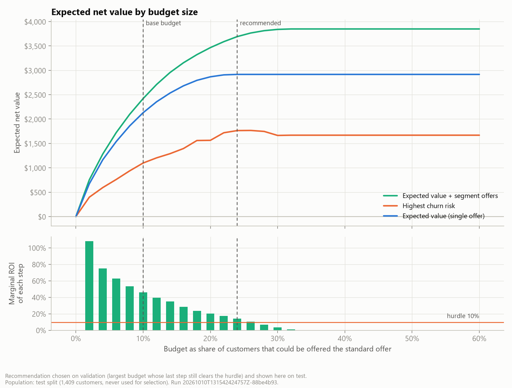

<!-- Generated from src/telco_retention/templates/reports/executive-brief.md.j2 for run 20261010T131542424757Z-88be4b93. Edit the template, not this file. -->
# Executive brief: profit-aware retention targeting

**To:** Head of Customer Retention | **From:** Retention analytics team | **Decision requested:** approve a 90-day retention pilot

## Recommendation

Stop allocating the retention budget to "the customers most likely to leave". Allocate it to the customers for whom **churn risk x customer value x the offer's save rate** most exceeds the cost of the offer, and give each customer an offer their segment qualifies for. Start with a **randomised pilot** on the recommended list: one wave of 1,550 customers (22% of the 7,043-customer base), half held out as a control group. Scale up only if the measured save rate clears that list's **13.9% break-even**.

## Why: the same budget returns more

Results for 1,409 held-out customers with a fixed $3,500 budget (enough to offer 10% of them the standard offer):

| Option | Customers contacted | Expected net value | ROI | Precision among contacted | High-risk/high-value coverage |
|---|---:|---:|---:|---:|---:|
| Do nothing | 0 | $0 | n/a | n/a | 0.0% |
| Call highest churn risk | 140 | $1,098 | 31% | 70.0% | 3.9% |
| Expected value, standard offer | 140 | $2,130 | 61% | 62.1% | 96.1% |
| **Expected value + segment offers** | **152** | **$2,420** | **69%** | **59.9%** | **100.0%** |

- **Better targeting earns $1,032 more (94%) for the same spend.** Using what these customers actually did, the gain is $1,308 (95% interval $509 to $2,153).
- **Why:** risk-only targeting spends the budget on high-risk customers whose remaining value is too small to repay an offer. It reaches only 4% of the high-risk, high-value customers, against 100% for the recommended rule. It has higher precision but less value.
- **Segment offers add $290** under the assumed save rates. Checked against actual outcomes the gain is not distinguishable from zero (-$27), so the pilot must test the offers, not just the list.

## How much to spend

Each extra budget step returns less (figure). We keep only the steps that still earn at least a 10% marginal return; this was decided on validation data. That rule recommends **$6.00 per customer in the base** (enough for the standard offer to 24% of customers; about $42,238 for all 7,043). On the test customers this buys 310 offers (22% of customers) for $8,450, an expected net value of $3,692 (ROI 44%). Beyond 27% of customers contacted, nobody left has positive expected value, so further budget should not be spent.

## How sure are we?

- **The model ranks customers well:** ROC-AUC 0.83, PR-AUC 0.62 (random contact: 0.27). Predicted churn is within 2.0 percentage points of observed churn on average. It predicts who leaves, not who an offer would keep.
- **Break-even:** the base-budget list stays profitable while the true save rate is above **11.8%**, the larger recommended list above **13.9%**; we assume 20%. Below 8.9% nobody is worth contacting.
- **Scenarios:** expected net value is $0 pessimistic (no campaign is run), $2,420 base and $18,525 optimistic. A list frozen under the pessimistic case would lose $2,797.
- **Biggest uncertainties:** save rate of the standard offer and value horizon (months).

## Risks and guardrails

- **No causal evidence yet.** Save rates are documented assumptions. Contacting customers can even raise churn, so the pilot keeps a random control group.
- **Sample data.** The IBM sample describes a fictional US company with 26.5% churn; real US carriers lose about 1% of postpaid customers per month. The results show that the method works, not how big the prize is. Retrain on our own data before rollout.
- **Fairness and experience.** Senior customers are contacted 3.7x as often as others, because they are higher-risk and pay more; age and gender are not model inputs. Loyal, low-risk customers rarely get offers, so watch for "loyalty penalty" complaints.
- **Compliance (Vietnam).** Prior consent and a Do-Not-Call check are required. Advertising calls are limited to one per 24 hours, between 08:00 and 17:00 (Decree 91/2020). A data-protection impact assessment is required under the Personal Data Protection Law 2025.

## Decisions requested

1. Approve one pilot wave: 775 customers contacted and 775 held out. Offer and contact budget about $21,125.
2. Name owners: Retention (offers and script), Call centre (capacity), Finance (margin and offer cost), Legal/DPO (consent and DPIA).
3. Agree the decision rule now. After 90 days: **go** (scale to the recommended budget) if the offer effect is statistically significant and the measured save rate is at least 13.9%; **stop** if it is clearly below; otherwise run one more wave. If the true save rate is 20%, this rule says go 94% of the time.
