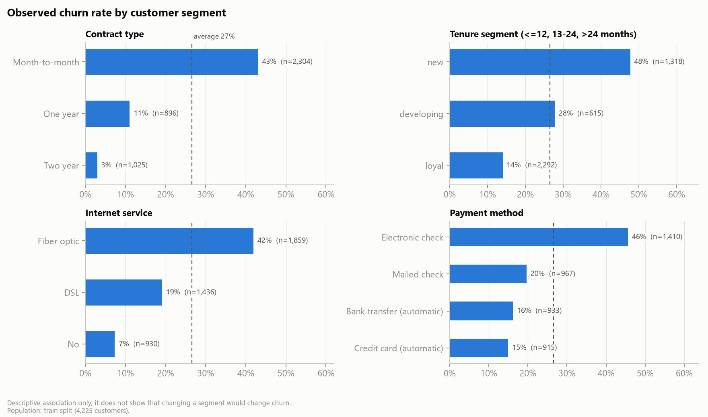
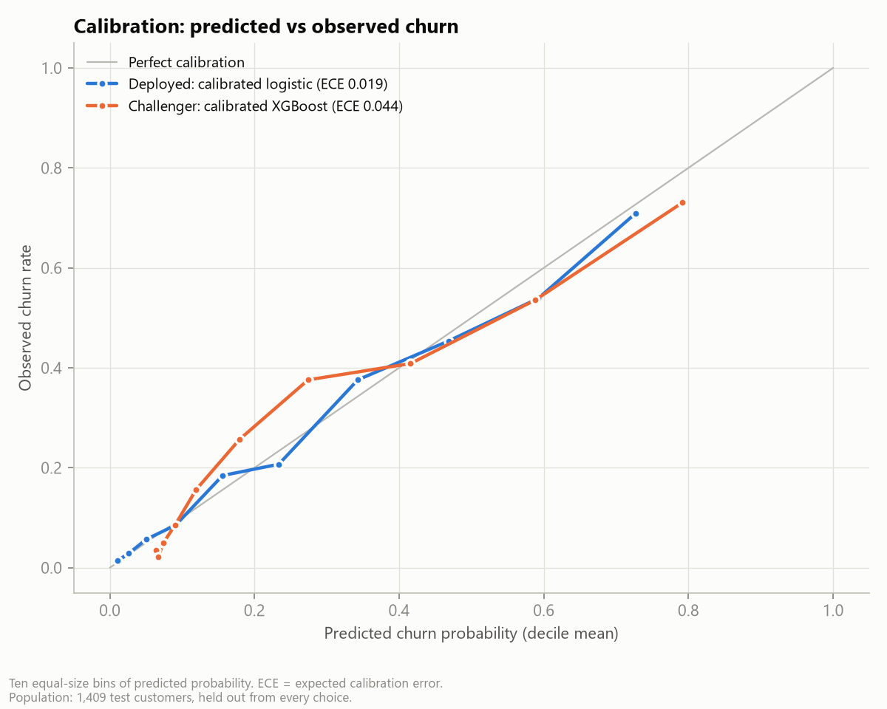
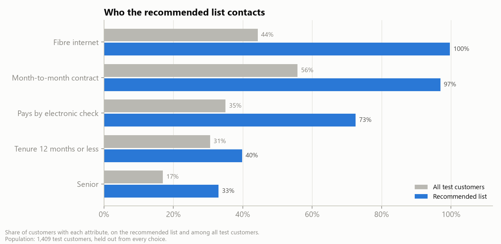
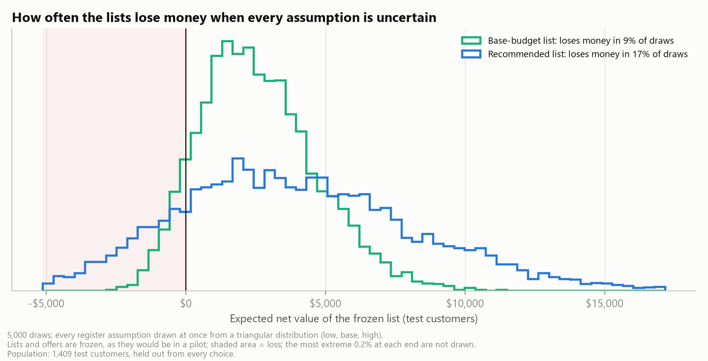
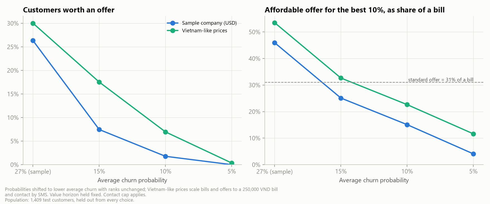

<!-- Generated from src/telco_retention/templates/presentation/deck.md.j2 for run 20261010T155849068129Z-88be4b93. Edit the template, not this file. -->
# Spend the retention budget where it returns the most
## Profit-aware churn and retention targeting - Business Analytics capstone, Topic 7

- Decision: which customers get a retention offer, which offer, and how much to spend
- Answer: rank by expected value, not by churn risk alone, and prove the save rate in a pilot
- Ask: approve one randomised pilot wave of 1,620 customers

Notes: Open with the decision and the answer. The data are IBM's fictional US telco sample; every dollar figure belongs to that company. Agenda: summary, the problem in money, the model, the rule, who we target, value, budget, downside, outside the sample, fairness, the pilot, the ask, then a live demo.

---

# Target by expected value, then prove the save rate
## Executive summary

- Same $3,500 budget: +$1,368 expected versus calling the riskiest customers
- Who: fibre customers on monthly contracts with high bills; not low-risk or low-bill customers
- Budget: about $45,737 for the base; stop where the next step returns under 10%
- Who to target is robust; how much an offer saves (20% assumed) is not
- Ask: one pilot wave, half held out, about $22,875 of offers and contacts

Notes: If management remembers one slide, it is this one. The targeting gain holds in 100% of assumption draws; the save rate is the open question, which is why the ask is a pilot and not a roll-out.

---

# Churn puts $468,468 of margin at risk
## Today's rule calls the riskiest customers, whatever they are worth

- 26.5% of customers churn; monthly-contract, new, fibre and e-cheque customers most
- The budget covers an offer for 10% of customers
- Every offer costs money, even when the customer would have stayed
- Owner: Head of Retention; Finance approves budget; Legal/DPO approves contact

Notes: $468,468 is twelve months of expected margin lost to churn across 7,043 customers ($93,720 on the 1,409 test customers). The question is not who will leave but where an offer pays back. Our KPIs: expected net value, ROI, customers contacted, precision among contacted and coverage of high-risk, high-value customers.

---

# The model ranks churners well and is checked in money

- Logistic regression, chosen over random forest and XGBoost by a rule fixed in advance
- Finds churners: ROC-AUC 0.83; PR-AUC 0.62 vs 0.27 by chance
- Probabilities within 1.9 points of observed churn
- In money the three models are within $194 on validation
- It predicts who leaves, not who an offer would keep

Notes: Calibration matters because we multiply probabilities by money. All three model families rank about equally, so the simpler and interpretable model wins; its odds ratios also become a points card for the call centre. Every choice was made on validation; the test customers were used once, for reporting.

---

# Offer only where expected value beats the cost
## Expected value = churn probability x save rate x customer value - (offer + contact cost)

- Contact only customers with positive expected value
- An optimiser picks customers and one offer each within budget, at most 30% contacted
- Four offers with eligibility rules: bill credit, contract upgrade, service bundle, loyalty reward
- Every cost and save rate is a visible, sourced assumption

Notes: Worked example: a customer paying 70 dollars a month is worth about $239 over a year of margin; at 60% risk the standard offer is worth $3.73 net. The save rate is the share of would-be leavers an offer keeps; we assume 20%, below the 30% common in the literature.

---

# The list is fibre, month-to-month and high-bill

- 100% fibre and 97% monthly contracts, against 44% and 56% overall
- Median bill $89 against $70
- No offer for low-risk customers: most would stay anyway
- Few offers for risky low-bill customers: their value cannot repay the offer

Notes: The whole campaign rides on one segment's response, so the pilot should report results for fibre and monthly-contract customers separately. Offers: $35 credit for moving to a 1-year contract for 150, 6 months free techsupport + onlinesecurity for 150, one-time $20 bill credit for 24.
---

# Same budget, more value
| Rule | Customers | Net value | ROI | Precision | HR/HV coverage |
|---|---|---|---|---|---|
| Highest churn risk (today) | 140 | $1,301 | 37% | 71% | 12% |
| Expected value, one offer | 140 | $2,340 | 67% | 60% | 96% |
| Recommended: + segment offers | 153 | $2,668 | 76% | 60% | 98% |

- +$1,368 expected: $1,039 from who we target, $328 from which offer

Notes: Same customers, budget and assumptions. Precision is the share of contacted customers who actually left; risk-only is more precise but spends on customers who are not worth an offer. Valued with what these customers actually did, the gain is $1,077 (95% interval $229 to $2,002); the offer-matching part is not proven, so the pilot tests offers too.

---

# Spend about $45,737 - then stop

- Each extra step reaches customers with less expected value
- Keep steps that return at least 10% (set on validation): $6.49 per customer
- Test customers: 324 offers, $9,150, net $4,145 (ROI 45%)
- Beyond 26% of customers nobody is worth an offer

Notes: The x-axis is the budget expressed as the share of customers the standard offer could reach. The recommended budget is about 2.6 times today's; it is only worth committing once the pilot confirms the save rate.

---

# Who to target is robust; how much an offer saves is not

- Break-even save rate: 11.3% (base list), 13.8% (recommended); assumed 20%
- All assumptions uncertain: the recommended list loses money in 17% of draws
- Beats risk-only in 100% of draws
- Only 46% of churners left for price or a competitor's offer

Notes: 5,000 draws, every register assumption at once. Value horizon (months) and save rate of the standard offer drive most of the spread. If offers only reach churners who left for price or a competitor, a 20% save rate means keeping 43% of them: ambitious. Below 8.5% nobody is worth contacting.

---

# Outside the sample the margins get thinner

- Real churn is far below the sample's 27%
- At 15% churn only 7% of customers are worth this offer
- Vietnamese prices: small bills but SMS contact keeps 18% worth an offer
- Lower churn needs larger pilots; rebuild the model on our own data

Notes: Probabilities were shifted to lower average churn with the ranking unchanged. The Vietnam-like rows use a 250,000 VND home-fibre bill and an SMS of 500 VND. In Vietnam most mobile customers are prepaid, so the model must be rebuilt; see the deployment note.

---

# Fairness, experience and compliance are managed

- Seniors contacted 3.3x as often as others (2.6x under today's rule)
- 1.7x after adjusting for risk: reviewed with Legal/DPO before each wave
- Age and gender are not model inputs; every wave is audited
- Consent, Do-Not-Call checks, contact limits and a data-protection impact assessment

Notes: An offer is a benefit (a discount) and a burden (a call). The new rule widens the senior gap compared with today's, partly because seniors pay more; the pilot reports seniors separately and Legal/DPO reviews each wave. Loyal low-risk customers rarely get offers, so watch for loyalty-penalty complaints.

---

# The pilot measures what we assumed
- 1,620 customers: 810 offered, 810 held out at random
- Save rate = 1 - churn of offered / churn of held out, after 90 days
- One wave detects a save rate of about 12%; break-even is 13.8%
- Cost about $22,875; expected net value of the offered half $10,363
- Decision about 19 weeks after approval: set-up, outcome window, read-out

Notes: Randomising inside the target list gives the causal effect the data cannot. The price of learning is the value forgone on the held-out half, about $10,363. Measured save rates replace the assumptions and the whole analysis re-runs.

---

# Decisions requested
- Approve one pilot wave: 1,620 customers, half held out, about $22,875
- Name owners: Retention, Call centre, Finance, Legal/DPO
- Agree the rule now: go if significant and at least 13.8%; stop if clearly below
- Otherwise extend, at most 2 more waves

Notes: Close with the ask. If the true save rate is 20%, the rule says go after one wave 95% of the time. The significance test protects against acting on noise; the break-even test protects the budget.

---

# Live demo: the dashboard
- Decision page: KPIs, who gets an offer, action list and export
- Assumptions page: change the save rate and watch the chance of a loss move
- Model evidence: odds ratios and the points scorecard

Notes: Follow the demo script: show the default view, change the budget, open the action list and explain one customer, export the campaign file, then lower the save rate on the assumptions page and show when not running the campaign is the right decision.
